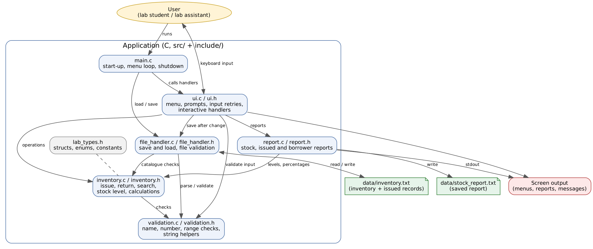
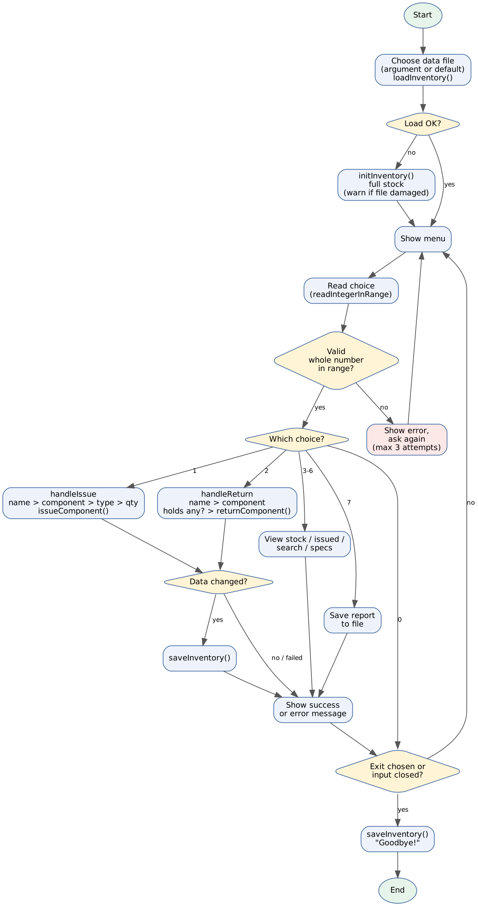

# 1. Project Information

## 1.1 Project Title

Project title: Electronics Lab Components Inventory Tracker

## 1.2 Engineering Domain

Engineering domain:

Electronics

## 1.3 Team Details

| Field | Details |
|---|---|
| Student name | Shruti Lonkar |
| Roll number | 612507185 |
| Division / batch | EnTc Div 2 |
| Repository name | electronics-lab-components |
| GitHub repository link | https://github.com/s7rvti/electronics-lab-components |

## 1.4 Individual Project Declaration

I confirm that this project is my individual work. I understand the design, source code, unit tests, Makefile and documentation included in this repository, and I am prepared to explain or modify any part during evaluation.

Student signature or acknowledgement:

[Enter your acknowledgement here]

---

# 2. Engineering Scenario

## 2.1 Scenario Description

**Where the scenario occurs:** In a college electronics laboratory, at the component counter, during every practical session.

**Who is involved:** Students who borrow components for experiments, and the lab assistant who looks after the stock.

**Current working method:** Borrowed components are noted in a paper register, or not noted at all. Stock is counted by hand now and then.

**Information that must be managed:**

- The component types the lab owns (resistor, capacitor, inductor, transistor, MOSFET, jumper wires) and a fixed total quantity of each
- The exact specification of each item (for example a 10k resistor or a BC547 transistor)
- Who borrowed which item and how many
- How many of each component are currently available

**Problems in the current method:**

- Nobody knows the real stock at a given moment
- Students take the wrong value or type, or take more than is available
- Items are not returned, or are returned without being recorded
- Shortages are noticed only when an experiment has already started
- Paper records are easy to lose or misread

Project-specific description:

The lab owns a fixed number of common electronic components. Students borrow them and are expected to return them. This project replaces the paper register with a C program that checks availability, records the borrower and the exact specification, tracks returns, and keeps the data in a text file so it is still there after the program is closed.

---

## 2.2 Problem Statement

Final problem statement:

In an electronics laboratory, students and lab staff currently face the problem of tracking borrowed components on paper or from memory. The current method results in wrong stock counts, students taking the wrong component values, items that are never returned, and shortages found only when an experiment is already under way. The proposed software will provide issue and return logging with specification choice, stock checking, low-stock detection, search and reports so that users can get the right component quickly and staff can always see the real stock and who holds what.

---

## 2.3 Proposed Solution

Proposed solution:

A menu-driven C application with a modular multi-file design.

**What the application will do:** Issue components to a named borrower, take returns, search by borrower name, show reports, and save everything to a text file.

**How it addresses the problem:** The user picks a component and then an exact type from a numbered list, so wrong or mistyped values are avoided. The program refuses to issue more than what is available, and refuses a return for something the person never took. Data is saved after every change.

**Information it manages:** Component catalogue with fixed totals, available quantity of each component, and a list of issue records (borrower, component, specification, quantity).

**Calculations and decisions:**

- Utilisation percentage and available percentage of each component
- Stock status for each component: OK, LOW (20% or less left) or OUT OF STOCK
- A low-stock warning right after an issue
- Sorting components by scarcity (scarcest first)
- Merging repeated issues of the same item to the same person
- Checking the data file for consistency when loading

**Reports and outputs:** A stock report (total, available, issued, utilisation %, status), an issued-components report, a per-borrower report, and a report saved to `data/stock_report.txt`.

---

## 2.4 Target Users

| User Type | Responsibility | How the User Will Use the Application |
|---|---|---|
| Student | Borrows and returns components for experiments | Takes a component by choosing its type and quantity, returns it later, checks what they hold |
| Lab assistant | Looks after the stock and the issue counter | Views the stock report, finds who holds a component, saves the report, watches for low stock |
| Faculty / lab in-charge | Plans purchases and monitors usage | Reads the saved stock report to decide what to restock |

---

# 3. Project Scope

## 3.1 In-Scope Features

1. Issue components to a named borrower with a quantity check against available stock
2. Choose the specification from a numbered list for resistors, capacitors, inductors, transistors and MOSFETs (jumper wires have none)
3. Return components, including partial returns, only for items the borrower actually holds
4. Search issued records by borrower name
5. Stock report with utilisation percentage, OK / LOW / OUT OF STOCK status, sorted scarcest first
6. Low-stock warning after an issue
7. Issued-components report and a report saved to a text file
8. Automatic saving to a text file and loading at start-up, with detection of empty, damaged or inconsistent files
9. Input validation and error handling for all user input

## 3.2 Out-of-Scope Features

1. Graphical or web interface
2. User accounts, passwords or roles
3. Return dates, due dates, fines and reminders
4. Adding new component types or changing totals while the program runs
5. Several people using the same data file at the same time

## 3.3 Assumptions

1. One person uses the program at a time
2. Borrower names are a single word made of letters, digits, `_` or `-`
3. The component list, totals and specifications are decided by the lab and change rarely
4. The data file is changed only by this program

## 3.4 Constraints

1. Command-line interface only
2. Data stored in a plain text file
3. Maximum of 100 issued records at one time
4. The C code uses only `stdio.h` (string helpers are written in the project)
5. Unit tests are written in C++ with Google Test
6. Code must compile without warnings using `-Wall -Wextra -Wpedantic`

---

# 4. Requirements

## 4.1 Functional Requirements

| ID | Functional Requirement | Priority | Verification Method |
|---|---|---|---|
| FR-01 | The system shall issue a quantity of a component to a named borrower and reduce the available stock. | High | Test (UT-16, UT-20, UT-27) / Demonstration |
| FR-02 | The system shall let the user choose the specification from a displayed list for every component except jumper wires. | High | Test (UT-18, UT-19, UT-21) / Demonstration |
| FR-03 | The system shall refuse to issue more than the available quantity. | High | Test (UT-22) / Demonstration |
| FR-04 | The system shall merge repeated issues of the same component and specification to the same borrower into one record. | Medium | Test (UT-25, UT-26) |
| FR-05 | The system shall accept a return only for items the borrower holds, and only up to the quantity held. | High | Test (UT-28 to UT-32) / Demonstration |
| FR-06 | The system shall tell the user and stop the return if the borrower never issued the chosen component. | High | Test (UT-33, UT-34) / Demonstration |
| FR-07 | The system shall validate names, menu choices, component numbers, specification numbers and quantities. | High | Test (UT-01 to UT-15, UT-23, UT-24) / Negative testing |
| FR-08 | The system shall save the inventory and issued records to a text file after every successful change and load them at start-up. | High | Test (UT-41 to UT-43, UT-55 to UT-57) / Demonstration |
| FR-09 | The system shall detect a missing, empty, damaged or inconsistent data file and continue safely. | High | Test (UT-44 to UT-54) / Demonstration |
| FR-10 | The system shall search issued records by borrower name. | Medium | Test (UT-35, UT-65, UT-66) / Demonstration |
| FR-11 | The system shall show a stock report with total, available, issued, utilisation percentage and status for each component, scarcest first. | Medium | Test (UT-36, UT-37, UT-39, UT-40, UT-59 to UT-62, UT-67) |
| FR-12 | The system shall determine stock status (OUT OF STOCK, LOW, OK) and warn the user when an issue leaves a component low or out of stock. | Medium | Test (UT-38, UT-58, UT-60) / Demonstration |
| FR-13 | The system shall list all currently issued components. | Medium | Test (UT-63, UT-64, UT-67) / Demonstration |
| FR-14 | The system shall display every component type and its specifications. | Low | Test (UT-17) / Demonstration |
| FR-15 | The system shall save the stock and issued reports to a text file. | Low | Test (UT-68, UT-69) / Demonstration |

## 4.2 Non-Functional Requirements

| ID | Non-Functional Requirement | Verification Method |
|---|---|---|
| NFR-01 | The source code shall compile without warnings. | Build output |
| NFR-02 | The project shall use a modular multi-file structure. | Code review |
| NFR-03 | The application shall handle invalid input without crashing. | Negative testing |
| NFR-04 | Important functions shall be tested using gTest. | Unit-test output |
| NFR-05 | The project shall build using a Makefile. | Build demonstration |
| NFR-06 | The project shall be maintained in a GitHub repository. | Repository review |
| NFR-07 | A damaged data file shall never cause wrong stock figures to be loaded. | Test (UT-45 to UT-53) |
| NFR-08 | The program shall have no global variables and shall check every pointer before use. | Code review / Test (NULL-pointer tests) |

## 4.3 Requirement Traceability

| Requirement ID | Module | Function or Feature | Test ID |
|---|---|---|---|
| FR-01 | inventory | `issueComponent`, `initInventory` | UT-16, UT-20, UT-27 |
| FR-02 | inventory, ui | `getSpecName`, `isKnownSpec`, `promptSpec` (ui) | UT-18, UT-19, UT-21 |
| FR-03 | inventory | `issueComponent` (stock check) | UT-22 |
| FR-04 | inventory | `issueComponent` (merge) | UT-25, UT-26 |
| FR-05 | inventory | `returnComponent` | UT-28, UT-29, UT-30, UT-31, UT-32 |
| FR-06 | inventory, ui | `findHeldRecords`, `handleReturn` | UT-33, UT-34 |
| FR-07 | validation, ui | `isValidName`, `parseInteger`, `isInRange`, `readIntegerInRange` | UT-01 to UT-15, UT-23, UT-24 |
| FR-08 | file_handler | `saveInventory`, `loadInventory` | UT-41, UT-42, UT-43, UT-55, UT-56, UT-57 |
| FR-09 | file_handler | `loadInventory` validation | UT-44 to UT-54 |
| FR-10 | inventory, report | `findRecordsByBorrower`, `writeBorrowerReport` | UT-35, UT-65, UT-66 |
| FR-11 | inventory, report | `calculateUtilisationPercent`, `sortComponentsByScarcity`, `writeStockReport` | UT-36, UT-37, UT-39, UT-40, UT-59 to UT-62 |
| FR-12 | inventory, report, ui | `getStockLevel`, `getStockLevelLabel`, low-stock warning in `handleIssue` | UT-38, UT-58, UT-60 |
| FR-13 | report | `writeIssuedReport` | UT-63, UT-64 |
| FR-14 | inventory, ui | `getComponentName`, `getSpecCount`, `handleViewSpecs` | UT-17 |
| FR-15 | report | `saveReportToFile` | UT-68, UT-69 |

---

# 5. High-Level Architecture

## 5.1 Architecture Description

The software is organised in layers, and each layer only uses the layers below it.

- **Control layer:** `main.c` starts the program, loads the saved data, runs the menu loop and saves on exit. It contains no business logic.
- **User-interface layer:** the `ui` module is the only code that reads the keyboard. It shows the menu, asks questions with retries, and calls the other modules.
- **Logic layer:** the `inventory` module holds the rules: issue, return, search, stock level, calculations and sorting. It never reads the keyboard or touches files, so it can be tested directly.
- **Supporting modules:** `validation` (input checks and string helpers), `file_handler` (saving and loading the data file) and `report` (formatting reports to any `FILE *`: screen, file or test buffer).
- **Shared definitions:** `lab_types.h` holds the structures, enumerations and constants used by every module.

The whole state lives in one `Inventory` variable created in `main` and passed to functions by pointer. There are no global variables.

## 5.2 Architecture Diagram

## 5.3 High-Level Workflow

1. The program starts and chooses the data file (command-line argument, or `data/inventory.txt`).
2. It loads the saved data. If the file is missing it starts with full stock. If the file is empty, damaged or inconsistent it warns the user and starts with full stock.
3. The menu is shown and the user picks an option. An invalid choice is rejected and asked again (3 attempts).
4. **Take a component:** name, component, type, quantity, then issue, confirmation, low-stock warning, save.
5. **Return a component:** name, component. If nothing was issued the program says so and stops. Otherwise it lists what the person holds, asks which one and how many, returns it and saves.
6. **View, search or report options:** the matching report is shown on screen, or saved to a file.
7. On Exit (or when input ends) the data is saved and the program ends.

---

# 6. Module Design

## 6.1 Module Summary

| Module Name | Source File | Header File | Responsibility |
|---|---|---|---|
| Main application | main.c | Not applicable | Controls the high-level application flow |
| User interface | ui.c | ui.h | Menu, prompts with retries, interactive handlers |
| Inventory logic | inventory.c | inventory.h | Component catalogue, issue, return, search, stock level, calculations, sorting |
| Validation | validation.c | validation.h | Input checks and string helpers |
| File handling | file_handler.c | file_handler.h | Saving and loading the data file, checking its contents |
| Reports | report.c | report.h | Stock, issued and borrower reports (screen, file or buffer) |

The shared header `lab_types.h` holds the structures, enumerations and constants used by all modules. It has no source file.

## 6.2 Detailed Module Description

### Module: Main application

Source file:

main.c

Header file:

Not applicable

Purpose:

Entry point. Starts the program, loads data, runs the menu loop and saves on exit.

Responsibilities:

- Choose the data file (command-line argument or default)
- Load saved data, or start with full stock if the file is missing or damaged
- Show the menu and call the matching handler
- Save the data and exit

Public functions:

- `main`

Data used or owned:

One `Inventory` variable, the data-file path and the menu choice.

Dependencies:

ui, inventory, file_handler

Possible errors:

`STATUS_ERR_FILE_FORMAT` or `STATUS_ERR_FILE_OPEN` when loading (handled by starting fresh), a failed save on exit (warning shown), `STATUS_ERR_INPUT_CLOSED` (exit).

### Module: User interface

Source file:

ui.c

Header file:

ui.h

Purpose:

All communication with the user: the menu, prompts, and one handler for each menu action.

Responsibilities:

- Read lines safely with `fgets` and re-ask on invalid input (3 attempts)
- Show component and specification lists
- Run the issue and return conversations and call the logic module
- Show success, warning and error messages
- Save the data file after every successful change

Public functions:

- `printMenu`, `readIntegerInRange`
- `handleIssue`, `handleReturn`, `handleViewStock`, `handleViewIssued`
- `handleSearchBorrower`, `handleViewSpecs`, `handleSaveReport`

Data used or owned:

Keyboard line buffer (`INPUT_LINE_SIZE`), the `MenuChoice` values. The `Inventory` is passed in by pointer.

Dependencies:

inventory, file_handler, report, validation

Possible errors:

`STATUS_ERR_INVALID_INPUT`, `STATUS_ERR_INPUT_CLOSED`, plus any status returned by the modules it calls.

### Module: Inventory logic

Source file:

inventory.c

Header file:

inventory.h

Purpose:

The rules of the lab: what is stocked, who holds what, and how much is left.

Responsibilities:

- Own the read-only component catalogue (names, fixed totals, specifications)
- Issue and return components and keep stock and records consistent
- Merge repeated issues of the same item
- Search records by borrower and component
- Calculate utilisation and available percentages, and decide the stock level
- Sort components by scarcity

Public functions:

- `getComponentName`, `getComponentTotal`, `getSpecCount`, `getSpecName`, `isKnownSpec`
- `initInventory`, `issueComponent`, `returnComponent`
- `findHeldRecords`, `findRecordsByBorrower`
- `calculateUtilisationPercent`, `calculateAvailablePercent`, `countIssuedItems`
- `getStockLevel`, `sortComponentsByScarcity`

Data used or owned:

A private constant table (`CATALOGUE`) of component names, totals and specifications. It operates on the caller's `Inventory`.

Dependencies:

validation

Possible errors:

`STATUS_ERR_NULL_POINTER`, `STATUS_ERR_INVALID_COMPONENT`, `STATUS_ERR_INVALID_NAME`, `STATUS_ERR_INVALID_SPEC`, `STATUS_ERR_INVALID_QUANTITY`, `STATUS_ERR_INSUFFICIENT_STOCK`, `STATUS_ERR_CAPACITY_FULL`, `STATUS_ERR_NOT_FOUND`.

### Module: Validation

Source file:

validation.c

Header file:

validation.h

Purpose:

Checks for user and file input, and small string helpers (the project uses only `stdio.h`).

Responsibilities:

- Validate names, integers, ranges and component numbers
- Convert text to integers safely, rejecting trailing junk and overflow
- Bounded string copy, string comparison, length and newline trimming

Public functions:

- `isValidName`, `parseInteger`, `isInRange`, `isValidComponent`
- `copyString`, `stringsEqual`, `stringLength`, `trimNewline`

Data used or owned:

None. All functions work on the arguments they receive.

Dependencies:

None (uses `lab_types.h` only)

Possible errors:

`STATUS_ERR_NULL_POINTER`, `STATUS_ERR_INVALID_INPUT`, `STATUS_ERR_BUFFER_TOO_SMALL`.

### Module: File handling

Source file:

file_handler.c

Header file:

file_handler.h

Purpose:

Make the data survive between program runs and protect against bad files.

Responsibilities:

- Write the available counts and every issued record to a text file
- Read the file back, validate every line and check that the numbers add up
- Replace the caller's data only if the entire file is valid

Public functions:

- `saveInventory`, `loadInventory`

Data used or owned:

A temporary `Inventory` used while loading. Private line buffer (`LINE_SIZE`).

Dependencies:

inventory, validation

Possible errors:

`STATUS_ERR_NULL_POINTER`, `STATUS_ERR_FILE_OPEN`, `STATUS_ERR_FILE_WRITE`, `STATUS_ERR_FILE_FORMAT`.

### Module: Reports

Source file:

report.c

Header file:

report.h

Purpose:

Build the text reports from the inventory data.

Responsibilities:

- Stock report with percentages and status, scarcest first
- Issued-components report
- Report of everything one borrower holds
- Save reports to a file

Public functions:

- `getStockLevelLabel`, `writeStockReport`, `writeIssuedReport`, `writeBorrowerReport`, `saveReportToFile`

Data used or owned:

None. Writers take a `FILE *`, so the same code prints to the screen, a file or a test buffer.

Dependencies:

inventory, validation

Possible errors:

`STATUS_ERR_NULL_POINTER`, `STATUS_ERR_FILE_OPEN`, `STATUS_ERR_FILE_WRITE`.

---

# 7. Data Design

## 7.1 Structure Definitions

### Structure: IssueRecord

Purpose:

Represents one line in the log: a borrower holding a quantity of one component of one specification.

Proposed definition:

    typedef struct
    {
        char          borrower[NAME_SIZE];
        ComponentType component;
        char          spec[SPEC_SIZE];
        int           quantity;
    } IssueRecord;

Member details:

| Member | C Type | Valid Range or Size | Description |
|---|---|---|---|
| borrower | char[30] | 1 to 29 characters | Name of the person holding the items |
| component | ComponentType | 0 to 5 | Kind of component |
| spec | char[20] | one catalogue entry, or `-` | Specification such as `10k` or `BC547` |
| quantity | int | 1 to the component total | Number of items held |

### Structure: Inventory

Purpose:

Represents everything the program remembers: how many of each component are in the lab, and the list of issue records.

Proposed definition:

    typedef struct
    {
        int         available[COMP_COUNT];
        IssueRecord records[MAX_RECORDS];
        int         recordCount;
    } Inventory;

Member details:

| Member | C Type | Valid Range or Size | Description |
|---|---|---|---|
| available | int[6] | 0 to the component total | Items of each component currently in the lab |
| records | IssueRecord[100] | `recordCount` used entries | The issue records |
| recordCount | int | 0 to 100 | Number of records in use |

Rule that always holds: for every component, `available + sum of record quantities = fixed total`. It is checked when a file is loaded.

## 7.2 Enumeration Definitions

### Enumeration: ComponentType

Purpose:

Names the six kinds of component. `COMP_COUNT` is the number of kinds and is used for array sizes and loops.

Proposed definition:

    typedef enum
    {
        COMP_RESISTOR = 0,
        COMP_CAPACITOR,
        COMP_INDUCTOR,
        COMP_TRANSISTOR,
        COMP_MOSFET,
        COMP_JUMPER_WIRE,
        COMP_COUNT
    } ComponentType;

| Enumeration Constant | Meaning |
|---|---|
| COMP_RESISTOR | Resistors |
| COMP_CAPACITOR | Capacitors |
| COMP_INDUCTOR | Inductors |
| COMP_TRANSISTOR | Transistors |
| COMP_MOSFET | MOSFETs |
| COMP_JUMPER_WIRE | Jumper wires (no specification) |
| COMP_COUNT | Number of component kinds (not a real component) |

### Enumeration: StatusCode

Purpose:

The result of every operation that can fail (see Section 11).

Proposed definition:

    typedef enum
    {
        STATUS_OK = 0,
        STATUS_ERR_NULL_POINTER,
        STATUS_ERR_INVALID_COMPONENT,
        STATUS_ERR_INVALID_SPEC,
        STATUS_ERR_INVALID_QUANTITY,
        STATUS_ERR_INVALID_NAME,
        STATUS_ERR_INVALID_INPUT,
        STATUS_ERR_INSUFFICIENT_STOCK,
        STATUS_ERR_CAPACITY_FULL,
        STATUS_ERR_NOT_FOUND,
        STATUS_ERR_BUFFER_TOO_SMALL,
        STATUS_ERR_FILE_OPEN,
        STATUS_ERR_FILE_WRITE,
        STATUS_ERR_FILE_FORMAT,
        STATUS_ERR_INPUT_CLOSED
    } StatusCode;

| Enumeration Constant | Meaning |
|---|---|
| STATUS_OK | Operation succeeded |
| STATUS_ERR_* | A specific failure, listed in the error catalogue (Section 11.2) |

### Enumeration: StockLevel

Purpose:

How much of a component is left in the lab.

Proposed definition:

    typedef enum
    {
        STOCK_OUT = 0,
        STOCK_LOW,
        STOCK_OK
    } StockLevel;

| Enumeration Constant | Meaning |
|---|---|
| STOCK_OUT | None left |
| STOCK_LOW | 20% or less of the total is left |
| STOCK_OK | More than 20% is left |

### Enumeration: MenuChoice

Purpose:

Gives names to the main-menu options.

Proposed definition:

    typedef enum
    {
        MENU_EXIT = 0,
        MENU_ISSUE,
        MENU_RETURN,
        MENU_STOCK,
        MENU_ISSUED,
        MENU_SEARCH,
        MENU_SPECS,
        MENU_SAVE_REPORT
    } MenuChoice;

| Enumeration Constant | Meaning |
|---|---|
| MENU_EXIT | Save and quit |
| MENU_ISSUE | Take a component |
| MENU_RETURN | Return a component |
| MENU_STOCK | View the stock report |
| MENU_ISSUED | View issued components |
| MENU_SEARCH | Search by borrower name |
| MENU_SPECS | View all component types and specifications |
| MENU_SAVE_REPORT | Save the report to a file |

## 7.3 Constants

| Constant | Value | Purpose |
|---|---:|---|
| NAME_MAX_CHARS | 29 | Longest borrower name |
| NAME_SIZE | 30 | Name buffer size including the end character |
| SPEC_MAX_CHARS | 19 | Longest specification text |
| SPEC_SIZE | 20 | Specification buffer size |
| MAX_RECORDS | 100 | Most issued records at one time |
| MAX_SPECS_PER_COMPONENT | 10 | Most specifications a component can have |
| PERCENT_FULL | 100 | Used in percentage calculations |
| LOW_STOCK_PERCENT | 20 | At or below this share left means LOW |
| NO_SPEC_LABEL | "-" | Specification stored for jumper wires |
| DEFAULT_DATA_FILE | "data/inventory.txt" | Saved inventory |
| DEFAULT_REPORT_FILE | "data/stock_report.txt" | Saved report |
| MAX_INTEGER_TEXT_LEN | 9 | Longest number text accepted (prevents overflow) |
| INPUT_LINE_SIZE | 64 | Keyboard line buffer size |
| MAX_INPUT_ATTEMPTS | 3 | Wrong answers allowed before a prompt gives up |
| LINE_SIZE | 128 | Line buffer used when reading the data file |

## 7.4 Data Dictionary

| Data Item | C Type | Valid Range or Size | Validation Rule | Description |
|---|---|---|---|---|
| borrower | char[30] | 1 to 29 characters | Letters, digits, `_`, `-` only (`isValidName`) | Who holds the items |
| component | ComponentType | 0 to 5 | `isValidComponent` | Kind of component |
| spec | char[20] | One entry of that component's list | `isKnownSpec` | Specification such as `10k`, `BC547` or `-` |
| quantity (record) | int | 1 to the component total | Range check on issue, return and file load | Items held |
| available[i] | int | 0 to the total of component i | Range check on file load; changed only by issue and return | Items in the lab |
| recordCount | int | 0 to 100 | Capacity check on issue and file load | Number of records |
| menu choice | int | 0 to 7 | `readIntegerInRange` | Selected menu option |
| issue quantity | int | 1 to available | `readIntegerInRange`, `issueComponent` | How many to take |
| return quantity | int | 1 to quantity held | `readIntegerInRange`, `returnComponent` | How many to give back |

---

# 8. Function Design

## 8.1 Function: issueComponent

Module:

inventory

Prototype:

    StatusCode issueComponent(Inventory *inv, const char *borrower,
                              ComponentType component, int specIndex, int quantity);

Purpose:

Give items to a borrower and update the stock. A repeated issue of the same item to the same person is merged into one record.

Parameters:

| Parameter | C Type | Direction | Description | Valid Values |
|---|---|---|---|---|
| inv | Inventory * | Input-Output | The inventory to update | Not NULL |
| borrower | const char * | Input | Borrower name | 1 to 29 letters, digits, `_`, `-` |
| component | ComponentType | Input | Component to issue | 0 to 5 |
| specIndex | int | Input | 0-based position in the specification list (ignored for jumper wires) | 0 to spec count - 1 |
| quantity | int | Input | Number of items | 1 to available |

Return type:

StatusCode

Return values:

| Return Value | Meaning |
|---|---|
| STATUS_OK | Issued successfully |
| STATUS_ERR_NULL_POINTER | `inv` or `borrower` is NULL |
| STATUS_ERR_INVALID_COMPONENT | Component out of range |
| STATUS_ERR_INVALID_NAME | Name empty, too long or has illegal characters |
| STATUS_ERR_INVALID_SPEC | Specification index out of range |
| STATUS_ERR_INVALID_QUANTITY | Quantity is zero or negative |
| STATUS_ERR_INSUFFICIENT_STOCK | Quantity is more than the available stock |
| STATUS_ERR_CAPACITY_FULL | 100 records already in use |

Preconditions:

- `inv` was initialised or loaded

Postconditions:

- On success, available stock is reduced by `quantity` and a record exists for this borrower, component and specification
- On any error, nothing changes

Errors handled:

- NULL pointers, bad component, name, specification and quantity, not enough stock, full record list

Related requirements:

- FR-01, FR-02, FR-03, FR-04, FR-07

Planned unit tests:

- UT-20, UT-21, UT-22, UT-23, UT-24, UT-25, UT-26, UT-27

## 8.2 Function: returnComponent

Module:

inventory

Prototype:

    StatusCode returnComponent(Inventory *inv, int recordIndex, int quantity);

Purpose:

Take items back from one issue record and put them back into stock. The record is removed when its quantity reaches zero.

Parameters:

| Parameter | C Type | Direction | Description | Valid Values |
|---|---|---|---|---|
| inv | Inventory * | Input-Output | The inventory to update | Not NULL |
| recordIndex | int | Input | Index of the record being returned | 0 to recordCount - 1 |
| quantity | int | Input | Number of items returned | 1 to the quantity held |

Return type:

StatusCode

Return values:

| Return Value | Meaning |
|---|---|
| STATUS_OK | Returned successfully |
| STATUS_ERR_NULL_POINTER | `inv` is NULL |
| STATUS_ERR_NOT_FOUND | Record index is out of range |
| STATUS_ERR_INVALID_QUANTITY | Quantity below 1 or above the quantity held |

Preconditions:

- The record index came from `findHeldRecords`

Postconditions:

- Available stock increases by `quantity`
- The record shrinks, or is removed (later records shift up by one place)

Errors handled:

- NULL pointer, bad index, bad quantity (nothing changes on error)

Related requirements:

- FR-05

Planned unit tests:

- UT-28, UT-29, UT-30, UT-31, UT-32

## 8.3 Function: findHeldRecords

Module:

inventory

Prototype:

    int findHeldRecords(const Inventory *inv, const char *borrower,
                        ComponentType component, int matches[], int maxMatches);

Purpose:

Find the records one person holds for one component. Used by the return operation to stop early when nothing was issued.

Parameters:

| Parameter | C Type | Direction | Description | Valid Values |
|---|---|---|---|---|
| inv | const Inventory * | Input | The inventory to search | Not NULL |
| borrower | const char * | Input | Name to look for | Not NULL |
| component | ComponentType | Input | Component to look for | 0 to 5 |
| matches | int[] | Output | Receives the record indexes | Not NULL |
| maxMatches | int | Input | Size of `matches` | 1 or more |

Return type:

int

Return values:

| Return Value | Meaning |
|---|---|
| 0 | Nothing found, or an argument was NULL |
| 1 or more | Number of records found (never more than `maxMatches`) |

Preconditions:

- `matches` has room for `maxMatches` integers

Postconditions:

- `matches[0 .. result-1]` hold valid record indexes

Errors handled:

- NULL pointers (returns 0)

Related requirements:

- FR-06

Planned unit tests:

- UT-33, UT-34

## 8.4 Function: getStockLevel

Module:

inventory

Prototype:

    StockLevel getStockLevel(const Inventory *inv, ComponentType component);

Purpose:

Decide whether a component is out of stock, low or fine.

Parameters:

| Parameter | C Type | Direction | Description | Valid Values |
|---|---|---|---|---|
| inv | const Inventory * | Input | The inventory | Not NULL |
| component | ComponentType | Input | Component to check | 0 to 5 |

Return type:

StockLevel

Return values:

| Return Value | Meaning |
|---|---|
| STOCK_OUT | None left (also returned for invalid arguments) |
| STOCK_LOW | `available * 100 <= total * 20` |
| STOCK_OK | More than 20% left |

Preconditions:

- None

Postconditions:

- The inventory is not changed

Errors handled:

- NULL pointer and invalid component are treated as out of stock

Related requirements:

- FR-12

Planned unit tests:

- UT-38 (boundary: 21 left = OK, 20 left = LOW, 1 left = LOW, 0 left = OUT)

## 8.5 Function: calculateUtilisationPercent

Module:

inventory

Prototype:

    int calculateUtilisationPercent(const Inventory *inv, ComponentType component);

Purpose:

Calculate what percentage of a component is currently issued out.

Parameters:

| Parameter | C Type | Direction | Description | Valid Values |
|---|---|---|---|---|
| inv | const Inventory * | Input | The inventory | Not NULL |
| component | ComponentType | Input | Component to measure | 0 to 5 |

Return type:

int

Return values:

| Return Value | Meaning |
|---|---|
| 0 to 100 | `(total - available) * 100 / total` (integer division) |
| 0 | Invalid arguments |

Preconditions:

- None

Postconditions:

- The inventory is not changed

Errors handled:

- NULL pointer, invalid component (division by zero is avoided)

Related requirements:

- FR-11

Planned unit tests:

- UT-36

## 8.6 Function: sortComponentsByScarcity

Module:

inventory

Prototype:

    StatusCode sortComponentsByScarcity(const Inventory *inv, ComponentType order[COMP_COUNT]);

Purpose:

Fill an array with all component types ordered by available percentage, lowest first. Components with equal percentages keep catalogue order (stable insertion sort).

Parameters:

| Parameter | C Type | Direction | Description | Valid Values |
|---|---|---|---|---|
| inv | const Inventory * | Input | The inventory | Not NULL |
| order | ComponentType[6] | Output | Receives the sorted component types | Not NULL |

Return type:

StatusCode

Return values:

| Return Value | Meaning |
|---|---|
| STATUS_OK | `order` is filled |
| STATUS_ERR_NULL_POINTER | `inv` or `order` is NULL |

Preconditions:

- `order` has room for `COMP_COUNT` entries

Postconditions:

- `order` contains every component type exactly once

Errors handled:

- NULL pointers

Related requirements:

- FR-11

Planned unit tests:

- UT-39, UT-40

## 8.7 Function: isValidName

Module:

validation

Prototype:

    int isValidName(const char *name);

Purpose:

Check that a borrower name is safe to store and to read back from the data file.

Parameters:

| Parameter | C Type | Direction | Description | Valid Values |
|---|---|---|---|---|
| name | const char * | Input | Text to check | Any (NULL allowed, returns 0) |

Return type:

int

Return values:

| Return Value | Meaning |
|---|---|
| 1 | 1 to 29 characters, all letters, digits, `_` or `-` |
| 0 | Empty, NULL, too long, or contains other characters (including spaces) |

Preconditions:

- None

Postconditions:

- The text is not changed

Errors handled:

- NULL, empty, over-long and illegal characters

Related requirements:

- FR-07

Planned unit tests:

- UT-01, UT-02, UT-03, UT-04

## 8.8 Function: parseInteger

Module:

validation

Prototype:

    StatusCode parseInteger(const char *text, int *value);

Purpose:

Safely convert typed text to an integer.

Parameters:

| Parameter | C Type | Direction | Description | Valid Values |
|---|---|---|---|---|
| text | const char * | Input | Text such as `"42"` | Not NULL |
| value | int * | Output | Receives the number | Not NULL |

Return type:

StatusCode

Return values:

| Return Value | Meaning |
|---|---|
| STATUS_OK | Valid whole number; `*value` set |
| STATUS_ERR_INVALID_INPUT | Empty, letters, decimal, trailing junk, or longer than 9 characters; `*value` unchanged |
| STATUS_ERR_NULL_POINTER | `text` or `value` is NULL |

Preconditions:

- None

Postconditions:

- `*value` changes only on `STATUS_OK`

Errors handled:

- Empty input, non-numeric input, `5.5`, `5 apples`, numbers too long to be safe

Related requirements:

- FR-07

Planned unit tests:

- UT-05, UT-06, UT-07, UT-08, UT-09

## 8.9 Function: saveInventory

Module:

file_handler

Prototype:

    StatusCode saveInventory(const Inventory *inv, const char *path);

Purpose:

Write the inventory to a text file, replacing its old contents.

Parameters:

| Parameter | C Type | Direction | Description | Valid Values |
|---|---|---|---|---|
| inv | const Inventory * | Input | Data to save | Not NULL |
| path | const char * | Input | File name | Not NULL, writable location |

Return type:

StatusCode

Return values:

| Return Value | Meaning |
|---|---|
| STATUS_OK | Saved |
| STATUS_ERR_NULL_POINTER | `inv` or `path` is NULL |
| STATUS_ERR_FILE_OPEN | The file could not be opened for writing |
| STATUS_ERR_FILE_WRITE | A write or the close failed |

Preconditions:

- The folder of `path` exists

Postconditions:

- The file holds six count lines followed by one line per record

Errors handled:

- NULL pointers, failed `fopen`, failed `fprintf`, failed `fclose`

Related requirements:

- FR-08

Planned unit tests:

- UT-41, UT-42, UT-43, UT-55, UT-56

## 8.10 Function: loadInventory

Module:

file_handler

Prototype:

    StatusCode loadInventory(Inventory *inv, const char *path);

Purpose:

Read the saved inventory and refuse to use a file that is damaged or does not add up.

Parameters:

| Parameter | C Type | Direction | Description | Valid Values |
|---|---|---|---|---|
| inv | Inventory * | Output | Receives the data, only if the whole file is valid | Not NULL |
| path | const char * | Input | File name | Not NULL |

Return type:

StatusCode

Return values:

| Return Value | Meaning |
|---|---|
| STATUS_OK | File valid; `*inv` replaced |
| STATUS_ERR_NULL_POINTER | `inv` or `path` is NULL |
| STATUS_ERR_FILE_OPEN | File does not exist or cannot be opened |
| STATUS_ERR_FILE_FORMAT | Empty, damaged or inconsistent file |

Preconditions:

- None

Postconditions:

- `*inv` is unchanged on any error

Errors handled:

- Missing or empty file; non-numeric, negative or too-large counts; bad component number; unknown specification; wrong number of fields; more than 100 records; counts that do not match the records

Related requirements:

- FR-08, FR-09

Planned unit tests:

- UT-41 to UT-54, UT-57

## 8.11 Function: writeStockReport

Module:

report

Prototype:

    StatusCode writeStockReport(const Inventory *inv, FILE *out);

Purpose:

Write the stock table (total, available, issued, utilisation %, status) sorted scarcest first, followed by a summary and a restock count.

Parameters:

| Parameter | C Type | Direction | Description | Valid Values |
|---|---|---|---|---|
| inv | const Inventory * | Input | Data to report on | Not NULL |
| out | FILE * | Output | Screen, file or buffer to write to | Open for writing |

Return type:

StatusCode

Return values:

| Return Value | Meaning |
|---|---|
| STATUS_OK | Report written |
| STATUS_ERR_NULL_POINTER | `inv` or `out` is NULL |
| STATUS_ERR_FILE_WRITE | A write failed |

Preconditions:

- `out` is open for writing

Postconditions:

- The inventory is not changed

Errors handled:

- NULL pointers, failed writes

Related requirements:

- FR-11, FR-12

Planned unit tests:

- UT-59, UT-60, UT-61, UT-62, UT-67

## 8.12 Function: readIntegerInRange

Module:

ui

Prototype:

    StatusCode readIntegerInRange(const char *prompt, int min, int max, int *value);

Purpose:

Ask the user for a whole number in a range, asking again after a wrong answer.

Parameters:

| Parameter | C Type | Direction | Description | Valid Values |
|---|---|---|---|---|
| prompt | const char * | Input | Question text | Not NULL |
| min | int | Input | Lowest accepted number | Any |
| max | int | Input | Highest accepted number | At least `min` |
| value | int * | Output | Receives the number | Not NULL |

Return type:

StatusCode

Return values:

| Return Value | Meaning |
|---|---|
| STATUS_OK | Valid number received |
| STATUS_ERR_INVALID_INPUT | 3 wrong answers in a row |
| STATUS_ERR_INPUT_CLOSED | Input ended (end of file) |
| STATUS_ERR_NULL_POINTER | `prompt` or `value` is NULL |

Preconditions:

- None

Postconditions:

- `*value` is set only on `STATUS_OK`

Errors handled:

- Letters, empty input, decimals, out-of-range numbers, over-long lines, closed input

Related requirements:

- FR-07

Planned unit tests:

- None directly, because it reads the keyboard. The number conversion it relies on is tested by UT-05 to UT-09 and the range check by UT-10. The retry behaviour is covered by the application tests in Section 19.3.

---

# 9. Input-Validation Plan

| Input | Source | Validation Rule | Invalid Example | Expected Error Behaviour |
|---|---|---|---|---|
| Menu choice | User | Whole number 0 to 7 | `9`, `abc`, `2.5` | Message, ask again; after 3 wrong answers return to the menu |
| Component number | User | Whole number 1 to 6 | `0`, `99` | Same |
| Specification number | User | 1 to the number of types shown | `10` for a list of 9 | Same |
| Quantity to issue | User | 1 to the available quantity | `0`, `-3`, more than available | Same (the prompt shows the allowed range) |
| Quantity to return | User | 1 to the quantity held | `0`, more than held | Same |
| Item chosen to return | User | 1 to the number of items held | `5` when 2 are held | Same |
| Borrower name | User | 1 to 29 characters of letters, digits, `_`, `-` | `Amit Kumar`, empty, 30 characters | "Invalid name" message, ask again |
| Empty input | User | Not a number / not a name | (just Enter) | Treated as invalid |
| Number too long | User | At most 9 characters | `99999999999` | Rejected (prevents overflow) |
| Line too long | User | Fits the 64-character buffer | A very long line | Rest of the line discarded, treated as invalid |
| Closed input | User | Input must continue | Ctrl+D / end of file | Program saves and exits cleanly |
| Available counts in the file | File | Six numbers, each 0 to that component's total | `abc`, `-1`, `9999` | `STATUS_ERR_FILE_FORMAT`, start with full stock |
| Record lines in the file | File | Exactly 4 fields; valid name, component, specification; quantity 1 to total | `Amit 42 10k 3`, `Amit 0 BC547 3` | `STATUS_ERR_FILE_FORMAT`, start with full stock |
| Counts versus records | File | `available + issued = total` for every component | 3 resistors issued but count says 100 | `STATUS_ERR_FILE_FORMAT`, start with full stock |

Explain the common validation strategy:

Every value is checked at the point where it enters the program, and checked again inside the logic function that uses it. Keyboard input is read as a whole line with `fgets` and converted with `parseInteger`, which rejects anything that is not a plain whole number. Range checks use `isInRange`. The `ui` module re-asks a few times and then returns to the menu, so the user is never stuck. The logic functions (`issueComponent`, `returnComponent`) do not trust the interface and re-validate every argument, so they are safe even when called directly, for example from a unit test. File data is treated as untrusted in the same way and is checked before it replaces the program's data.

---

# 10. File-Handling Design

## 10.1 File Summary

| File | Purpose | Format | Created By | Read By | Updated By |
|---|---|---|---|---|---|
| data/inventory.txt | Current stock and issued records | Text | Program (first save) | Program at start-up | Program after every change and on exit |
| data/stock_report.txt | Saved stock and issued report | Text | Program ("Save report to file") | The user | Program (overwritten each time) |
| data/sample_data.txt | Example data for demonstration and one unit test | Text | Developer (committed in the repository) | Unit test UT-57, demonstration | Not changed by the program |

## 10.2 Record Format

The inventory file has six count lines followed by one line per issued record.

    85              (available Resistors)
    92              (available Capacitors)
    0               (available Inductors)
    48              (available Transistors)
    5               (available MOSFETs)
    30              (available Jumper wires)
    Amit 0 10k 5    (borrower, component number, specification, quantity)
    Riya 1 100nF 8

Each record line is `borrower component_number specification quantity`, separated by single spaces. Jumper wires use `-` as the specification (for example `Karan 5 - 170`). Blank lines are ignored.

## 10.3 File Operations

| Operation | Function or Module | C Library Function | Failure Handling |
|---|---|---|---|
| Create or open | `saveInventory`, `loadInventory` (file_handler); `saveReportToFile` (report) | `fopen` | NULL result returns `STATUS_ERR_FILE_OPEN`; a missing data file on start-up means start with full stock |
| Read | `loadInventory` | `fgets`, `sscanf` | Missing or malformed line returns `STATUS_ERR_FILE_FORMAT` |
| Write | `saveInventory`, report writers | `fprintf` | Negative result returns `STATUS_ERR_FILE_WRITE` |
| Update | `saveInventory` | `fopen` with mode `"w"` | The whole file is rewritten after every successful change |
| Close | `saveInventory`, `loadInventory`, `saveReportToFile` | `fclose` | A failed close is reported as an error |

## 10.4 File Error Conditions

| Error Condition | Detection Method | Expected Behaviour |
|---|---|---|
| File does not exist | `fopen` returns NULL on read | `STATUS_ERR_FILE_OPEN`; "No saved data found. Starting with full stock." |
| File cannot be opened | `fopen` returns NULL on write | `STATUS_ERR_FILE_OPEN`; warning shown that changes were not saved |
| File is empty | `fgets` returns NULL while reading the counts | `STATUS_ERR_FILE_FORMAT`; warning, start with full stock |
| File contains invalid data | Number, field-count, component, specification, quantity and consistency checks | `STATUS_ERR_FILE_FORMAT`; warning, start with full stock; the caller's data is untouched |
| Read or write fails | Return values of `fgets`, `fprintf` and `fclose` are checked | `STATUS_ERR_FILE_WRITE` or `STATUS_ERR_FILE_FORMAT`; a warning is shown and the program continues |

---

# 11. Error-Handling Strategy

## 11.1 Status Representation

Proposed status type:

    typedef enum
    {
        STATUS_OK = 0,
        STATUS_ERR_NULL_POINTER,
        STATUS_ERR_INVALID_COMPONENT,
        STATUS_ERR_INVALID_SPEC,
        STATUS_ERR_INVALID_QUANTITY,
        STATUS_ERR_INVALID_NAME,
        STATUS_ERR_INVALID_INPUT,
        STATUS_ERR_INSUFFICIENT_STOCK,
        STATUS_ERR_CAPACITY_FULL,
        STATUS_ERR_NOT_FOUND,
        STATUS_ERR_BUFFER_TOO_SMALL,
        STATUS_ERR_FILE_OPEN,
        STATUS_ERR_FILE_WRITE,
        STATUS_ERR_FILE_FORMAT,
        STATUS_ERR_INPUT_CLOSED
    } StatusCode;

## 11.2 Error Catalogue

| Error ID | Error Condition | Detection Location | Returned Status | User-Facing Behaviour |
|---|---|---|---|---|
| ERR-01 | A required pointer is NULL | Start of every logic, file and report function | STATUS_ERR_NULL_POINTER | "Internal error: missing data." (never reached in normal use) |
| ERR-02 | Component number out of range | `issueComponent` | STATUS_ERR_INVALID_COMPONENT | "That component does not exist." |
| ERR-03 | Specification number out of range | `issueComponent` | STATUS_ERR_INVALID_SPEC | "That specification does not exist." |
| ERR-04 | Quantity zero, negative, or more than held | `issueComponent`, `returnComponent` | STATUS_ERR_INVALID_QUANTITY | "Invalid quantity." |
| ERR-05 | Borrower name empty, too long or illegal characters | `isValidName`, `issueComponent` | STATUS_ERR_INVALID_NAME | "Invalid name. Use 1-29 letters, digits, '_' or '-' (no spaces)." |
| ERR-06 | Keyboard input wrong 3 times in a row | `readIntegerInRange`, name prompt | STATUS_ERR_INVALID_INPUT | "Too many invalid entries. Returning to the menu." |
| ERR-07 | More requested than available | `issueComponent` | STATUS_ERR_INSUFFICIENT_STOCK | "Not enough stock available." (or "no ... left in the lab") |
| ERR-08 | 100 records already in use | `issueComponent` | STATUS_ERR_CAPACITY_FULL | "The record list is full; no new issue can be logged." |
| ERR-09 | Person never issued that component, or bad record index | `findHeldRecords` (ui), `returnComponent` | STATUS_ERR_NOT_FOUND | "<name>, you have not issued any <component>. Nothing to return." |
| ERR-10 | Text does not fit its buffer | `copyString` | STATUS_ERR_BUFFER_TOO_SMALL | "Text is too long." |
| ERR-11 | Data file missing or cannot be opened | `loadInventory`, `saveInventory` | STATUS_ERR_FILE_OPEN | Start with full stock, or "changes were NOT saved" warning |
| ERR-12 | Write or close failure | `saveInventory`, report functions | STATUS_ERR_FILE_WRITE | "Could not write the file." warning |
| ERR-13 | File empty, damaged or inconsistent | `loadInventory` | STATUS_ERR_FILE_FORMAT | "Warning: <file> was empty or damaged. Starting with full stock." |
| ERR-14 | Keyboard input ended | `readIntegerInRange`, name prompt | STATUS_ERR_INPUT_CLOSED | Program saves the data and exits cleanly |

## 11.3 Recovery Strategy

- **Bad keyboard input:** the question is asked again, up to 3 times; after that the user returns to the menu.
- **Rejected operations:** every logic function checks everything before it changes anything, so a failed issue or return leaves the data exactly as it was.
- **Return of something never issued:** the program says so immediately and does not ask for the type or quantity.
- **Missing, empty or damaged data file:** the program starts with full stock. For a damaged file the user is warned that the file will be overwritten on the next save. The caller's data is never half-loaded.
- **Failed save:** a warning is shown and the program keeps running with the data in memory.
- **Closed input (end of file):** the program saves and exits normally instead of looping.

---

# 12. Coding Standards Plan

## 12.1 Naming Conventions

| Item | Convention | Example |
|---|---|---|
| Source files | lowercase, words joined with underscores | `file_handler.c` |
| Header files | same name as the source file | `file_handler.h` |
| Functions | camelCase, starting with a verb | `issueComponent`, `findHeldRecords` |
| Local variables | camelCase, meaningful names | `recordIndex`, `specIndex` |
| Structures | PascalCase | `IssueRecord`, `Inventory` |
| Enumerations | PascalCase type name; constants in UPPER_CASE with a prefix | `StatusCode`, `STATUS_ERR_FILE_OPEN`, `COMP_RESISTOR` |
| Constants | UPPER_CASE with underscores | `MAX_RECORDS`, `LOW_STOCK_PERCENT` |

## 12.2 Formatting Rules

- Indentation: 4 spaces, no tab characters
- Brace style: function braces on their own line; `if`, `for`, `while` and `switch` braces on the same line; braces are always used, even for a single statement
- Maximum line length: about 100 characters
- Compiler warning flags: `-Wall -Wextra -Wpedantic -std=c99`
- Comment style: `/* ... */` comments; headers describe each function's purpose, inputs and return values

## 12.3 Function Rules

- Each function has one clear responsibility and is small enough to understand and test
- Logic, file and report functions never read the keyboard; only the `ui` module does
- Every pointer argument is checked for NULL before use
- Every function that can fail returns a `StatusCode`, and the caller checks it
- A function changes nothing when it fails

## 12.4 Prohibited Practices

- Mutable global variables
- `scanf`, `gets` and other unbounded input functions
- Magic numbers (limits and rules are named constants)
- Ignoring the return value of a file or status-returning function
- Function bodies in header files
- Unused code left in the project

---

# 13. Application Flow

## 13.1 Main Application Flowchart

## 13.2 Operation Flow: Take a component (issue)

1. Ask for the borrower name; ask again if it is invalid.
2. Show the components with their available counts and ask which one.
3. If none is left, say so and return to the menu.
4. Show the numbered list of types for that component (skipped for jumper wires) and ask which one.
5. Ask for the quantity (1 to the available amount).
6. `issueComponent` checks everything, then updates stock and the record list (merging if the person already holds the same item).
7. Show "Issued ..." and, if the component is now low or out of stock, a warning.
8. Save the data file.

## 13.2 Operation Flow: Return a component

1. Ask for the borrower name; ask again if it is invalid.
2. Show the components and ask which one is being returned.
3. `findHeldRecords` looks for items of that component held by that person.
4. If none are found, print "you have not issued any <component>. Nothing to return." and return to the menu. No type or quantity is asked.
5. If several are found, list them with their quantities and ask which one.
6. Ask how many are being returned (1 to the quantity held).
7. `returnComponent` adds the items back to stock and shrinks or removes the record.
8. Show a thank-you message and save the data file.

---

# 14. Unit-Test Plan

## 14.1 Functions Selected for Testing

| Function | Module | Reason for Testing |
|---|---|---|
| `issueComponent` | inventory | Core operation: stock, records, merging and every error path |
| `returnComponent` | inventory | Core operation: restores stock, removes empty records |
| `findHeldRecords`, `findRecordsByBorrower` | inventory | Decide whether a return is allowed and power the search |
| `getStockLevel` | inventory | Decision logic with an exact 20% boundary |
| `calculateUtilisationPercent`, `calculateAvailablePercent`, `countIssuedItems` | inventory | Calculations shown in the reports |
| `sortComponentsByScarcity` | inventory | Sorting logic used by the stock report |
| `getSpecName`, `getSpecCount`, `isKnownSpec`, catalogue lookups | inventory | Safe access to the component catalogue |
| `isValidName`, `parseInteger`, `isInRange`, `isValidComponent` | validation | All input validation depends on them |
| `copyString`, `stringsEqual`, `trimNewline` | validation | Hand-written string helpers used everywhere |
| `saveInventory`, `loadInventory` | file_handler | Data persistence and protection against damaged files |
| `writeStockReport`, `writeIssuedReport`, `writeBorrowerReport`, `saveReportToFile`, `getStockLevelLabel` | report | Output correctness and ordering |

## 14.2 Test Cases

There are 69 tests in 4 files. Test IDs follow the order of the tests in each file.

**tests/test_validation.cpp (UT-01 to UT-15)**

| Test ID | Function | Category | Input or Condition | Expected Result | Requirement ID |
|---|---|---|---|---|---|
| UT-01 | isValidName | Positive | `Amit`, `student_01`, `A-B` | Valid (1) | FR-07 |
| UT-02 | isValidName | Negative | Empty text, NULL | Invalid (0) | FR-07 |
| UT-03 | isValidName | Negative | `Amit Kumar`, `am!t`, `a/b` | Invalid (0) | FR-07 |
| UT-04 | isValidName | Boundary | 1 character and 29 characters; 30 characters | 1 and 29 valid; 30 invalid | FR-07 |
| UT-05 | parseInteger | Positive | `42`, `-7` | STATUS_OK with 42 and -7 | FR-07 |
| UT-06 | parseInteger | Positive | `  15  ` (spaces around) | STATUS_OK with 15 | FR-07 |
| UT-07 | parseInteger | Negative | Empty, `abc`, `5.5`, `5 apples` | STATUS_ERR_INVALID_INPUT, value unchanged | FR-07 |
| UT-08 | parseInteger | Boundary | 9 digits; 10 digits | 9 digits accepted; 10 digits rejected | FR-07 |
| UT-09 | parseInteger | Negative | NULL text, NULL value pointer | STATUS_ERR_NULL_POINTER | FR-07 |
| UT-10 | isInRange | Boundary | 1 and 5 within 1-5; 0 and 6 | 1 and 5 inside; 0 and 6 outside | FR-07 |
| UT-11 | isValidComponent | Boundary | 0 and 5; -1 and 6 | 0 and 5 valid; -1 and 6 invalid | FR-07 |
| UT-12 | stringsEqual | Positive / Negative | `10k` vs `10k`; `10k` vs `10K`; `BC547` vs `BC54`; NULL | Equal only for identical text; NULL gives 0 | FR-07 |
| UT-13 | copyString | Positive | `BC547` into a 6-byte buffer | STATUS_OK, text copied | FR-07 |
| UT-14 | copyString | Negative | `BC547` into a 5-byte buffer; NULL arguments | STATUS_ERR_BUFFER_TOO_SMALL; STATUS_ERR_NULL_POINTER | FR-07 |
| UT-15 | trimNewline | Positive | `abc\n` and `abc` | Both become `abc` | FR-07 |

**tests/test_inventory.cpp (UT-16 to UT-40)**

| Test ID | Function | Category | Input or Condition | Expected Result | Requirement ID |
|---|---|---|---|---|---|
| UT-16 | initInventory | Positive | Fresh inventory | Every component at full stock, 0 records | FR-01 |
| UT-17 | getComponentName, getComponentTotal | Negative | Invalid component values | "Unknown" name, total 0 | FR-14 |
| UT-18 | getSpecName, getSpecCount | Boundary | First, last, one past the end, -1 for resistors; jumper wires | Valid names for 0 and 8; NULL for 9 and -1; jumper wires count 0 | FR-02 |
| UT-19 | isKnownSpec | Positive / Negative | `BC547` for transistor and for resistor; `-` and `10k` for jumper wires | Accepted only for the right component | FR-02 |
| UT-20 | issueComponent | Positive | Issue 4 x 10k resistor to Amit | Stock down by 4; record has name, spec, component, quantity | FR-01 |
| UT-21 | issueComponent | Positive | Issue jumper wires with spec index 99 | STATUS_OK; spec stored as `-` | FR-02 |
| UT-22 | issueComponent | Boundary | 0, -1, stock + 1, exactly all stock, then 1 more | INVALID_QUANTITY, INVALID_QUANTITY, INSUFFICIENT_STOCK, OK, INSUFFICIENT_STOCK | FR-03 |
| UT-23 | issueComponent | Negative | Bad component, bad spec index, empty name, name with space | Matching error code; no record created | FR-07 |
| UT-24 | issueComponent | Negative | NULL inventory, NULL borrower | STATUS_ERR_NULL_POINTER | FR-07 |
| UT-25 | issueComponent | Positive | Same item issued twice to the same person | One record with the summed quantity | FR-04 |
| UT-26 | issueComponent | Positive | Different spec, or different person | Separate records | FR-04 |
| UT-27 | issueComponent | Boundary | 100 records, then a 101st | 100th accepted; 101st STATUS_ERR_CAPACITY_FULL | FR-01 |
| UT-28 | returnComponent | Positive | Return all 4 items | Stock restored; record removed | FR-05 |
| UT-29 | returnComponent | Positive | Return 1 of 4 | Record shows 3; stock up by 1 | FR-05 |
| UT-30 | returnComponent | Boundary | Return 0, -1, more than held | STATUS_ERR_INVALID_QUANTITY; record unchanged | FR-05 |
| UT-31 | returnComponent | Negative | Nothing issued; index -1; index too large; NULL inventory | STATUS_ERR_NOT_FOUND; STATUS_ERR_NULL_POINTER | FR-05 |
| UT-32 | returnComponent | Positive | Remove the middle of three records | Other two remain, in order, with correct data | FR-05 |
| UT-33 | findHeldRecords | Positive / Negative | Person with two resistor records and one capacitor record; other person; other component | 2 matches for resistors; 0 for the others | FR-06 |
| UT-34 | findHeldRecords | Boundary | `maxMatches` of 1; NULL inventory | 1 result; 0 for NULL | FR-06 |
| UT-35 | findRecordsByBorrower | Positive / Negative | Person with records in two components; unknown person | 2 matches; 0 matches | FR-10 |
| UT-36 | calculateUtilisationPercent, calculateAvailablePercent | Boundary | 0, 25 and 100 of 100 resistors issued | 0%, 25%, 100% used; available percent matches | FR-11 |
| UT-37 | countIssuedItems | Positive / Negative | 4 resistors and 10 jumper wires; NULL | 14; 0 for NULL | FR-11 |
| UT-38 | getStockLevel | Boundary | 21, 20, 1 and 0 resistors left (total 100) | OK, LOW, LOW, OUT | FR-12 |
| UT-39 | sortComponentsByScarcity | Positive | MOSFET nearly gone, capacitors half gone | MOSFET first, capacitor second, rest in catalogue order | FR-11 |
| UT-40 | sortComponentsByScarcity | Negative | NULL inventory, NULL output array | STATUS_ERR_NULL_POINTER | FR-11 |

**tests/test_file_handler.cpp (UT-41 to UT-57)**

| Test ID | Function | Category | Input or Condition | Expected Result | Requirement ID |
|---|---|---|---|---|---|
| UT-41 | saveInventory, loadInventory | Positive | Save a mixed inventory and load it back | Counts and all records identical | FR-08 |
| UT-42 | saveInventory, loadInventory | Boundary | Full stock, no records | Loads with 0 records and full counts | FR-08 |
| UT-43 | saveInventory, loadInventory | Positive | Issue, return all, save, load | 0 records after loading | FR-08 |
| UT-44 | loadInventory | Negative | File does not exist | STATUS_ERR_FILE_OPEN | FR-09 |
| UT-45 | loadInventory | Negative | Empty file | STATUS_ERR_FILE_FORMAT | FR-09 |
| UT-46 | loadInventory | Negative | A count of 9999 (above the total) | STATUS_ERR_FILE_FORMAT | FR-09 |
| UT-47 | loadInventory | Negative | A count of -1 | STATUS_ERR_FILE_FORMAT | FR-09 |
| UT-48 | loadInventory | Negative | A count that is text (`abc`) | STATUS_ERR_FILE_FORMAT | FR-09 |
| UT-49 | loadInventory | Negative | Record with component number 42 | STATUS_ERR_FILE_FORMAT | FR-09 |
| UT-50 | loadInventory | Negative | Resistor record with specification `BC547` | STATUS_ERR_FILE_FORMAT | FR-09 |
| UT-51 | loadInventory | Negative | Record with an extra field; record with a missing field | STATUS_ERR_FILE_FORMAT | FR-09 |
| UT-52 | loadInventory | Negative | Counts that do not match the records (3 issued, count says 100) | STATUS_ERR_FILE_FORMAT | FR-09 |
| UT-53 | loadInventory | Negative | Damaged file loaded into existing data | Error returned; the caller's data is unchanged | FR-09 |
| UT-54 | loadInventory | Boundary | Blank lines between and after records | Loads normally; blanks ignored | FR-09 |
| UT-55 | saveInventory, loadInventory | Negative | NULL inventory or NULL path | STATUS_ERR_NULL_POINTER | FR-08 |
| UT-56 | saveInventory | Negative | Path in a folder that does not exist | STATUS_ERR_FILE_OPEN | FR-08 |
| UT-57 | loadInventory | Positive | `data/sample_data.txt` | Loads with 8 records; inductors at 0 | FR-08 |

**tests/test_report.cpp (UT-58 to UT-69)**

| Test ID | Function | Category | Input or Condition | Expected Result | Requirement ID |
|---|---|---|---|---|---|
| UT-58 | getStockLevelLabel | Positive | STOCK_OUT, STOCK_LOW, STOCK_OK | "OUT OF STOCK", "LOW", "OK" | FR-12 |
| UT-59 | writeStockReport | Positive | Fully stocked inventory | All six component names; "All components are sufficiently stocked."; no LOW | FR-11 |
| UT-60 | writeStockReport | Positive | MOSFETs low and inductors out | Report shows LOW, OUT OF STOCK and "Restock needed for 2 component type(s)." | FR-12 |
| UT-61 | writeStockReport | Positive | MOSFETs nearly gone | MOSFET row appears before Resistor row | FR-11 |
| UT-62 | writeStockReport | Positive | 4 resistors and 6 jumper wires issued | "Items currently issued: 10" | FR-11 |
| UT-63 | writeIssuedReport | Boundary | Nothing issued | "Nothing is currently issued." | FR-13 |
| UT-64 | writeIssuedReport | Positive | Two borrowers with different items | Names and specifications of both appear | FR-13 |
| UT-65 | writeBorrowerReport | Positive | Search for one of two borrowers | Only that person's items are shown | FR-10 |
| UT-66 | writeBorrowerReport | Negative | Search for someone with no items | "Nobody currently holds nothing." message | FR-10 |
| UT-67 | writeStockReport and others | Negative | NULL inventory, NULL output, NULL name | STATUS_ERR_NULL_POINTER | FR-11 |
| UT-68 | saveReportToFile | Positive | Save to a file and read it back | File contains "STOCK REPORT" and "ISSUED COMPONENTS" | FR-15 |
| UT-69 | saveReportToFile | Negative | Path in a folder that does not exist | STATUS_ERR_FILE_OPEN | FR-15 |

## 14.3 Test Data and Setup

- **Test input data:** every test builds its own data in code (for example `issueComponent(&inv, "Amit", COMP_RESISTOR, 5, 4)`). UT-57 also reads the committed `data/sample_data.txt`.
- **Temporary files:** file tests write to `test_data_tmp.txt` and the report-file test writes to `test_report_tmp.txt`, both in the folder where the tests run. Report content tests use `tmpfile()` and read the text back.
- **Initial conditions:** each test fixture creates a fresh, full `Inventory` in `SetUp()`, so tests do not depend on one another or on the order they run in.
- **Cleanup:** `TearDown()` deletes the temporary files. `make clean` also removes them.

## 14.4 Expected Test Command

    make test

---

# 15. Makefile Design

## 15.1 Required Targets

| Target | Purpose | Expected Output |
|---|---|---|
| all | Build the application | Each `src/*.c` file compiled to `build/*.o`, then linked into `lab_tracker`, with no warnings |
| run | Run the application | Builds if needed, then starts `./lab_tracker` and shows the menu |
| test | Build and execute unit tests | Builds `build/run_tests`, runs it, and prints the Google Test summary (69 tests passed) |
| clean | Remove generated files | `build/`, `lab_tracker` and temporary test files are deleted |

Only changed files are rebuilt. Dependency files generated with `-MMD -MP` make a changed header rebuild exactly the files that include it.

## 15.2 Build Configuration

| Item | Planned Value |
|---|---|
| C compiler | gcc |
| C++ compiler | g++ |
| C compiler flags | `-Wall -Wextra -Wpedantic -std=c99 -Iinclude` |
| C++ compiler flags | `-Wall -Wextra -Wpedantic -std=c++17 -Iinclude` |
| Include paths | `include/` (`-Iinclude`) |
| gTest libraries | `-lgtest -lgtest_main -pthread` (extra locations through `GTEST_INC` and `GTEST_LIB`) |
| Application executable | `lab_tracker` |
| Test executable | `build/run_tests` |

---

# 16. Repository Structure

Final project structure:

    electronics-lab-components/
    |
    |-- src/
    |   |-- main.c
    |   |-- ui.c
    |   |-- inventory.c
    |   |-- validation.c
    |   |-- file_handler.c
    |   `-- report.c
    |
    |-- include/
    |   |-- lab_types.h
    |   |-- ui.h
    |   |-- inventory.h
    |   |-- validation.h
    |   |-- file_handler.h
    |   `-- report.h
    |
    |-- tests/
    |   |-- test_validation.cpp
    |   |-- test_inventory.cpp
    |   |-- test_file_handler.cpp
    |   `-- test_report.cpp
    |
    |-- data/
    |   `-- sample_data.txt
    |
    |-- docs/
    |   |-- project_proposal.md
    |   |-- detailed_design.md
    |   |-- architecture.png
    |   |-- architecture.dot
    |   |-- flowchart.png
    |   `-- flowchart.dot
    |
    |-- Makefile
    |-- README.md
    |-- PROJECT_REPORT.md
    |-- .gitignore
    `-- LICENSE

`data/inventory.txt` and `data/stock_report.txt` are created when the program runs and are not committed.

---

# 17. Git and GitHub Plan

## 17.1 Repository Information

| Field | Value |
|---|---|
| Repository name | electronics-lab-components |
| Repository visibility | Public |
| Main branch | main |
| GitHub link | https://github.com/s7rvti/electronics-lab-components |

## 17.2 Planned Commit Milestones

| Milestone | Planned Commit Message | Status |
|---|---|---|
| Repository creation | Create initial project structure | Complete |
| Data design | Add shared types header (structures, enumerations, constants) | Planned |
| Validation module | Implement validation module and its unit tests | Planned |
| Core module | Implement inventory module (issue, return, search) | Planned |
| Core module | Add stock level calculations and sorting | Planned |
| File handling | Implement file handler with damaged-file detection | Planned |
| Reports | Implement report module | Planned |
| User interface | Implement menu and interactive handlers | Planned |
| Unit testing | Add unit tests for inventory, file handler and reports | Planned |
| Makefile | Add Makefile with run and test targets | Planned |
| Documentation | Add proposal, detailed design and diagrams | Planned |
| Documentation | Write README and add sample data | Planned |
| Verification | Fix issues found when cloning into a fresh directory | Planned |

## 17.3 Files to Ignore

Planned .gitignore entries:

    build/
    lab_tracker
    *.o
    *.d
    *.exe
    data/inventory.txt
    data/stock_report.txt
    test_data_tmp.txt
    test_report_tmp.txt
    core

---

# 18. Implementation Status

| Work Item | Status | Evidence or Commit |
|---|---|---|
| Proposal | Complete | `docs/project_proposal.md` |
| Detailed design | Complete | `docs/detailed_design.md` |
| Module 1: inventory | Complete | `src/inventory.c`, `include/inventory.h`; tests UT-16 to UT-40 |
| Module 2: validation | Complete | `src/validation.c`, `include/validation.h`; tests UT-01 to UT-15 |
| Module 3: user interface | Complete | `src/ui.c`, `include/ui.h`, `src/main.c` |
| Module 4: reports | Complete | `src/report.c`, `include/report.h`; tests UT-58 to UT-69 |
| File handling | Complete | `src/file_handler.c`, `include/file_handler.h`; tests UT-41 to UT-57 |
| Unit tests | Complete | `tests/*.cpp`; 69 tests passing |
| Makefile | Complete | `Makefile` (`all`, `run`, `test`, `clean`) |
| README | Complete | `README.md` |
| Repository verification | Not Started | Clone the repository into a new folder and run `make all` and `make test` |

---

# 19. Test Execution Results

## 19.1 Build Result

Command:

    make all

Result:

Pass

Warnings or errors:

None (compiled with `-Wall -Wextra -Wpedantic -std=c99`)

## 19.2 Unit-Test Result

Command:

    make test

Total tests:

69

Passed:

69

Failed:

0

Test-output evidence:

    [==========] 69 tests from 11 test suites ran.
    [  PASSED  ] 69 tests.

The tests were also run with the address and undefined-behaviour sanitizers (`-fsanitize=address,undefined`), with no errors reported.

## 19.3 Application Test Results

| Scenario | Input or Condition | Expected Result | Actual Result | Status |
|---|---|---|---|---|
| Normal use | Take 10 resistors of type 6 (10k) as `Amit` using the sample data | Item issued and stock reduced | "Issued 10 x Resistor (10k) to Amit." | Pass |
| Invalid input | Name `Amit Kumar`, then component entries `abc` and `99` | Each wrong entry rejected and asked again | "Invalid name. Use 1-29 letters, digits, '_' or '-' (no spaces)." and "Invalid input. Please type a whole number from 1 to 6." | Pass |
| Boundary value | Take 2 MOSFETs (IRF540) when exactly 5 are available (the quantity prompt shows 1-5) | Issued, then a low-stock warning | "Issued 2 x MOSFET (IRF540) to Amit." and "Warning: only 3 MOSFET left in the lab." | Pass |
| Missing record | Return a Capacitor as `Amit`, who never took one | Return stopped at once; no type or quantity asked | "Amit, you have not issued any Capacitor. Nothing to return." | Pass |
| File failure | Start the program with a data file that contains only the text `junk` | Damaged file detected; program starts with full stock | "Warning: <file> was empty or damaged. Starting with full stock (the file will be overwritten on the next save)." | Pass |

---

# 20. README Content Checklist

Confirm that README.md contains:

- [x] Project title
- [x] Engineering domain
- [x] Problem statement
- [x] Proposed solution
- [x] Features
- [x] Architecture diagram
- [x] Module descriptions
- [x] Folder structure
- [x] C concepts used
- [x] Coding standards
- [x] Prerequisites
- [x] Build instructions
- [x] Run instructions
- [x] Test instructions
- [x] Sample input
- [x] Sample output
- [x] Unit-testing summary
- [x] Error-handling summary
- [ ] Team members
- [x] Known limitations
- [x] Future enhancements
- [ ] GitHub repository link

---

# 21. Demonstration Plan

| Sequence | Demonstration Item | Approximate Time |
|---:|---|---|
| 1 | Introduce engineering scenario | 1 minute |
| 2 | Explain problem statement | 1 minute |
| 3 | Present requirements | 1 minute |
| 4 | Explain architecture | 1.5 minutes |
| 5 | Show repository structure | 1 minute |
| 6 | Build using make all | 0.5 minute |
| 7 | Run using make run | 0.5 minute |
| 8 | Demonstrate major features (take, return, search, stock report, low-stock warning, save report) | 3 minutes |
| 9 | Demonstrate invalid-input handling (bad name, bad number, return of an item never issued) | 1.5 minutes |
| 10 | Execute make test | 1 minute |
| 11 | Show commit history | 1 minute |
| 12 | Explain limitations and improvements | 1 minute |

---

# 22. Reflection

## 22.1 What Worked Well?

[Write your own response here]

## 22.2 Challenges Faced

[Write your own response here]

## 22.3 How Were the Challenges Resolved?

[Write your own response here]

## 22.4 What Did You Learn?

Discuss learning related to:

- C programming
- Modular design
- Coding standards
- Unit testing
- Makefiles
- Git
- GitHub

[Write your own response here]

## 22.5 Known Limitations

1. The component list, totals and specifications are fixed in the source code (`src/inventory.c`); changing them needs a recompile.
2. Borrower names cannot contain spaces.
3. There are no dates or due dates for returns, and no user accounts.
4. A damaged data file is replaced with full stock on the next save, so its old contents are lost.
5. Only one person can use the data file at a time; two copies of the program running together would overwrite each other's changes.
6. At most 100 separate issued records can exist at once.

## 22.6 Future Enhancements

1. Load the component catalogue from a configuration file instead of the source code.
2. Record issue and return dates and flag overdue items.
3. Keep stock per specification (for example the number of 10k resistors specifically).
4. Allow names with spaces and sort or filter the issued records by name or date.
5. Export reports as CSV.

---

# 23. Final Submission Checklist

## Proposal and Design

- [x] Project title is clear.
- [x] Engineering scenario is realistic.
- [x] Problem statement is specific.
- [x] Target users are identified.
- [x] Scope is defined.
- [x] Functional requirements are documented.
- [x] Non-functional requirements are documented.
- [x] Architecture diagram is included.
- [x] Modules are identified.
- [x] Data structures are designed.
- [x] Major functions are specified.
- [x] Error-handling strategy is defined.
- [x] Unit-test plan is complete.

## Implementation

- [x] Multiple C source files are used.
- [x] Header files are provided.
- [x] main.c contains high-level control only.
- [x] Structures are used meaningfully.
- [x] Functions have clear parameters and return values.
- [x] Input validation is implemented.
- [x] File operations are checked.
- [x] Errors are handled.
- [x] Coding standards are followed.
- [x] Code compiles without warnings.
- [x] No unnecessary or unused code remains.

## Unit Testing

- [x] gTest is used.
- [x] At least three important functions are tested.
- [x] At least ten meaningful tests are included.
- [x] Positive tests are included.
- [x] Negative tests are included.
- [x] Boundary tests are included.
- [x] Tests are independent and repeatable.
- [x] make test works.
- [x] All tests pass.

## Makefile

- [x] make all works.
- [x] make run works.
- [x] make test works.
- [x] make clean works.

## Git and GitHub

- [ ] Git was used throughout development.
- [ ] Multiple meaningful commits are present.
- [ ] .gitignore is configured.
- [ ] Generated files are not committed.
- [ ] GitHub contains the complete project.
- [ ] The repository was cloned and verified independently.
- [ ] The correct repository link is submitted.

## Documentation

- [ ] README is complete.
- [x] Architecture is documented.
- [x] Repository structure is documented.
- [x] Build instructions are correct.
- [x] Run instructions are correct.
- [x] Test instructions are correct.
- [x] Sample output is included.
- [x] Limitations are documented.
- [x] Future enhancements are documented.

---

# 24. Final Submission Information

Project title:

Electronics Lab Components Inventory Tracker

Engineering domain:

Electronics

Student name:

Shruti Lonkar

Roll number:

612507185

Division / batch:

EnTc Div 2

GitHub repository link:

https://github.com/s7rvti/electronics-lab-components

Project proposal location:

    docs/project_proposal.md

Detailed design location:

    docs/detailed_design.md

README location:

    README.md

Build command:

    make all

Run command:

    make run

Unit-test command:

    make test

Clean command:

    make clean

Submission date:

[Enter submission date]
