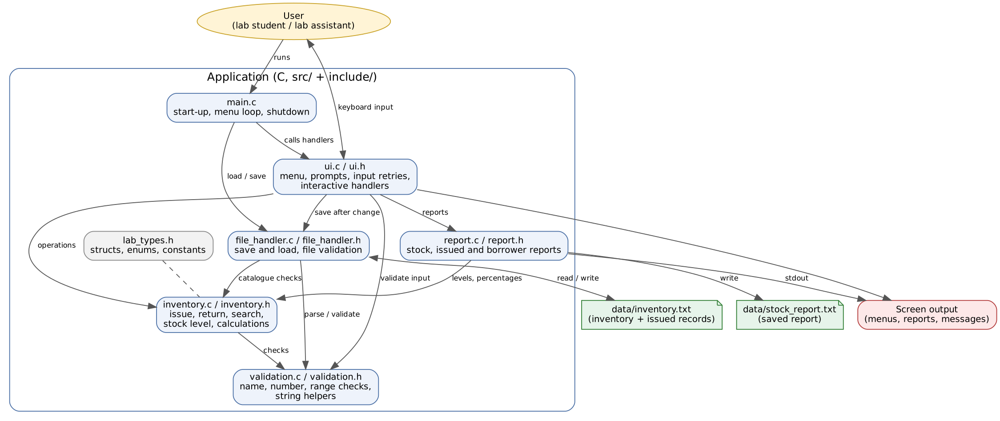
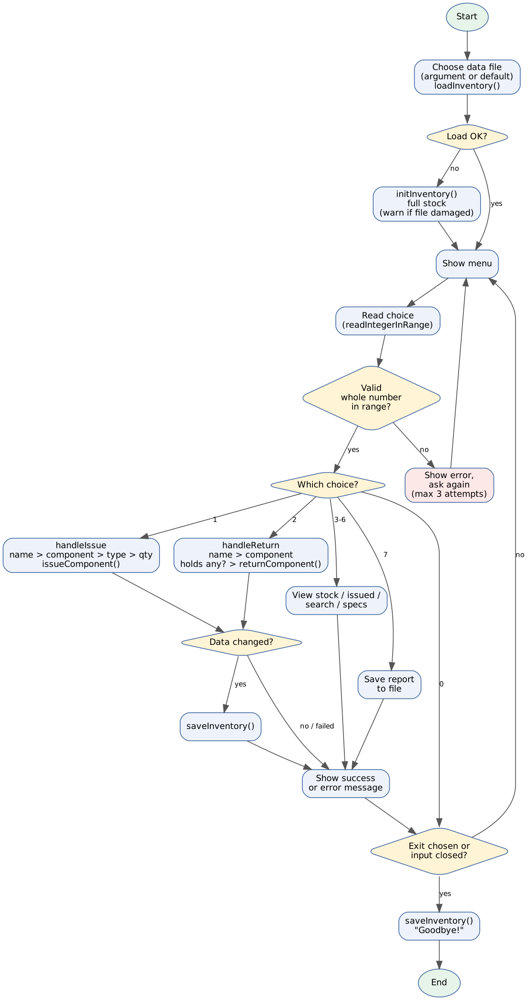

# Detailed Software Design: Lab Component Tracker

## 1. Software Architecture

The program is organised in layers. Each layer only calls layers below it.

| Layer | Module | Role |
|---|---|---|
| Control | `main.c` | Start-up, menu loop, shutdown |
| User interface | `ui` | All keyboard input and prompts, interactive handlers |
| Business logic | `inventory` | Rules: issue, return, search, stock status, calculations |
| Validation | `validation` | Checks for names, numbers and ranges; string helpers |
| File storage | `file_handler` | Save and load the inventory file |
| Reports | `report` | Format stock, issued and borrower reports |
| Shared data | `lab_types.h` | Structures, enumerations, constants |

Design rules:
- `inventory`, `validation`, `file_handler` and `report` never read the keyboard, so every function in them can be unit-tested without typing input.
- `report` writes to any `FILE *`, so the same code serves the screen, a report file and test buffers.
- The state lives in one `Inventory` variable created in `main` and passed by pointer. There are no global variables.



## 2. Module Design

| Module | Source | Header | Purpose | Depends on |
|---|---|---|---|---|
| main | `src/main.c` | none | Control flow | ui, inventory, file_handler |
| ui | `src/ui.c` | `include/ui.h` | Menu, prompts, handlers | inventory, file_handler, report, validation |
| inventory | `src/inventory.c` | `include/inventory.h` | Rules and calculations | validation |
| validation | `src/validation.c` | `include/validation.h` | Input checks, string helpers | none |
| file_handler | `src/file_handler.c` | `include/file_handler.h` | Persistence | inventory, validation |
| report | `src/report.c` | `include/report.h` | Reports | inventory, validation |

### Public functions per module

**inventory:** `getComponentName`, `getComponentTotal`, `getSpecCount`, `getSpecName`, `isKnownSpec`, `initInventory`, `issueComponent`, `returnComponent`, `findHeldRecords`, `findRecordsByBorrower`, `calculateUtilisationPercent`, `calculateAvailablePercent`, `countIssuedItems`, `getStockLevel`, `sortComponentsByScarcity`

**validation:** `stringLength`, `stringsEqual`, `copyString`, `trimNewline`, `isInRange`, `isValidComponent`, `isValidName`, `parseInteger`

**file_handler:** `saveInventory`, `loadInventory`

**report:** `getStockLevelLabel`, `writeStockReport`, `writeIssuedReport`, `writeBorrowerReport`, `saveReportToFile`

**ui:** `printMenu`, `readIntegerInRange`, `handleIssue`, `handleReturn`, `handleViewStock`, `handleViewIssued`, `handleSearchBorrower`, `handleViewSpecs`, `handleSaveReport`

## 3. Data Design

### 3.1 Structures

```c
typedef struct {
    char          borrower[NAME_SIZE];
    ComponentType component;
    char          spec[SPEC_SIZE];
    int           quantity;
} IssueRecord;

typedef struct {
    int         available[COMP_COUNT];
    IssueRecord records[MAX_RECORDS];
    int         recordCount;
} Inventory;
```

An `IssueRecord` says "this borrower holds this many of this component of this specification". `Inventory` holds the available count of each component plus the list of records. Relationship: for every component, `available + sum of record quantities = fixed total`. This is checked when a file is loaded.

### 3.2 Enumerations

| Enumeration | Values |
|---|---|
| `ComponentType` | `COMP_RESISTOR`, `COMP_CAPACITOR`, `COMP_INDUCTOR`, `COMP_TRANSISTOR`, `COMP_MOSFET`, `COMP_JUMPER_WIRE`, `COMP_COUNT` |
| `StockLevel` | `STOCK_OUT`, `STOCK_LOW`, `STOCK_OK` |
| `StatusCode` | `STATUS_OK` and the `STATUS_ERR_*` codes listed in section 7 |
| `MenuChoice` | `MENU_EXIT`, `MENU_ISSUE`, `MENU_RETURN`, `MENU_STOCK`, `MENU_ISSUED`, `MENU_SEARCH`, `MENU_SPECS`, `MENU_SAVE_REPORT` |

### 3.3 Constants

| Constant | Value | Meaning |
|---|---|---|
| `NAME_MAX_CHARS` / `NAME_SIZE` | 29 / 30 | Longest borrower name / buffer size |
| `SPEC_MAX_CHARS` / `SPEC_SIZE` | 19 / 20 | Longest specification / buffer size |
| `MAX_RECORDS` | 100 | Most issued records at once |
| `MAX_SPECS_PER_COMPONENT` | 10 | Most specifications per component |
| `PERCENT_FULL` | 100 | Used for percentage calculations |
| `LOW_STOCK_PERCENT` | 20 | At or below this share left = LOW |
| `NO_SPEC_LABEL` | `"-"` | Specification stored for jumper wires |
| `MAX_INTEGER_TEXT_LEN` | 9 | Longest number text accepted (prevents overflow) |
| `INPUT_LINE_SIZE` | 64 | Keyboard line buffer |
| `MAX_INPUT_ATTEMPTS` | 3 | Wrong answers allowed per prompt |
| `DEFAULT_DATA_FILE` | `data/inventory.txt` | Saved data |
| `DEFAULT_REPORT_FILE` | `data/stock_report.txt` | Saved report |

### 3.4 Component catalogue (fixed totals)

| Component | Total | Specifications |
|---|---|---|
| Resistor | 100 | 100, 220, 470, 1k, 4.7k, 10k, 47k, 100k, 1M |
| Capacitor | 100 | 100pF, 10nF, 100nF, 1uF, 10uF, 100uF, 1000uF |
| Inductor | 30 | 10uH, 100uH, 1mH, 10mH, 100mH |
| Transistor | 50 | BC547, BC557, 2N2222, 2N3904, 2N3055 |
| MOSFET | 30 | IRF540, IRF9540, IRFZ44N, 2N7000, IRLZ44N |
| Jumper wires | 200 | none |

### 3.5 Data dictionary

| Data item | C type | Valid range / size | Description | Validation rule |
|---|---|---|---|---|
| `borrower` | `char[30]` | 1 to 29 characters | Who holds the items | Letters, digits, `_`, `-` only (`isValidName`) |
| `component` | `ComponentType` | 0 to 5 | Component kind | `isValidComponent` |
| `spec` | `char[20]` | one catalogue entry | e.g. `10k`, `BC547`, or `-` | Must be in the catalogue for that component (`isKnownSpec`) |
| `quantity` (record) | `int` | 1 to the component total | Items held | Range check on issue, return and file load |
| `available[i]` | `int` | 0 to total of component i | Items in the lab | Range check on file load; changed only by issue / return |
| `recordCount` | `int` | 0 to 100 | Number of records | Capacity check on issue and file load |
| menu choice | `int` | 0 to 7 | Menu selection | `readIntegerInRange` |
| issue quantity | `int` | 1 to available | How many to take | `readIntegerInRange`, `issueComponent` |
| return quantity | `int` | 1 to quantity held | How many to give back | `readIntegerInRange`, `returnComponent` |

## 4. Function Design

All functions are in the module named. `StatusCode` values are listed in section 7.

### inventory

**`StatusCode issueComponent(Inventory *inv, const char *borrower, ComponentType component, int specIndex, int quantity)`**
- *Purpose:* give items to a borrower and update stock.
- *Inputs:* inventory; borrower name; component; 0-based specification index (ignored for jumper wires); quantity.
- *Outputs:* `inv` updated.
- *Returns:* `STATUS_OK`, `STATUS_ERR_NULL_POINTER`, `STATUS_ERR_INVALID_COMPONENT`, `STATUS_ERR_INVALID_NAME`, `STATUS_ERR_INVALID_SPEC`, `STATUS_ERR_INVALID_QUANTITY`, `STATUS_ERR_INSUFFICIENT_STOCK`, `STATUS_ERR_CAPACITY_FULL`.
- *Precondition:* `inv` was initialised or loaded.
- *Postcondition:* on success, `available[component]` is reduced by `quantity` and a record exists for this borrower/component/spec (merged if it already existed). On any error nothing changes.

**`StatusCode returnComponent(Inventory *inv, int recordIndex, int quantity)`**
- *Purpose:* take items back.
- *Returns:* `STATUS_OK`, `STATUS_ERR_NULL_POINTER`, `STATUS_ERR_NOT_FOUND` (bad record index), `STATUS_ERR_INVALID_QUANTITY` (below 1 or above the quantity held).
- *Postcondition:* `available` increases by `quantity`; the record shrinks, or is removed (later records shift up) when it reaches zero.

**`int findHeldRecords(const Inventory *inv, const char *borrower, ComponentType component, int matches[], int maxMatches)`**
- *Purpose:* find the records one person holds for one component.
- *Outputs:* `matches[]` filled with record indexes.
- *Returns:* number found (0 if none or if any pointer is NULL).

**`int findRecordsByBorrower(...)`** same as above across all components.

**`StockLevel getStockLevel(const Inventory *inv, ComponentType component)`**
- *Purpose:* decide OUT / LOW / OK.
- *Rule:* OUT if none left; LOW if `available * 100 <= total * LOW_STOCK_PERCENT`; otherwise OK (integer arithmetic, so the 20% boundary is exact). Invalid input is treated as OUT.

**`int calculateUtilisationPercent(const Inventory *inv, ComponentType component)`** returns `(total - available) * 100 / total`, or 0 for invalid arguments. **`calculateAvailablePercent`** returns `available * 100 / total`.

**`StatusCode sortComponentsByScarcity(const Inventory *inv, ComponentType order[COMP_COUNT])`**
- *Purpose:* order all components by available percentage, lowest first (stable insertion sort).
- *Returns:* `STATUS_OK` or `STATUS_ERR_NULL_POINTER`.

**`int countIssuedItems(const Inventory *inv)`** sums all record quantities (0 for NULL).

**`void initInventory(Inventory *inv)`** sets full stock and zero records (no effect on NULL).

**`const char *getComponentName(...)`, `int getComponentTotal(...)`, `int getSpecCount(...)`, `const char *getSpecName(...)`, `int isKnownSpec(...)`** read the private catalogue table and return a safe value (`"Unknown"`, 0, `NULL`, 0) for invalid arguments.

### validation

| Function | Purpose | Returns |
|---|---|---|
| `int isValidName(const char *name)` | Name rule: 1 to 29 characters, letters / digits / `_` / `-` | 1 valid, 0 invalid (also for NULL) |
| `StatusCode parseInteger(const char *text, int *value)` | Convert text to int; reject empty, letters, decimals, trailing junk, more than 9 characters | `STATUS_OK`, `STATUS_ERR_INVALID_INPUT`, `STATUS_ERR_NULL_POINTER`; `*value` unchanged on failure |
| `int isInRange(int value, int min, int max)` | Inclusive range check | 1 / 0 |
| `int isValidComponent(int component)` | 0 to `COMP_COUNT - 1` | 1 / 0 |
| `StatusCode copyString(char *dest, int destSize, const char *src)` | Bounded copy | `STATUS_OK`, `STATUS_ERR_NULL_POINTER`, `STATUS_ERR_BUFFER_TOO_SMALL` |
| `int stringsEqual(const char *a, const char *b)` | Exact comparison | 1 equal, 0 different or NULL |
| `int stringLength(const char *text)` | Length (0 for NULL) | length |
| `void trimNewline(char *line)` | Remove one trailing newline | none |

### file_handler

**`StatusCode saveInventory(const Inventory *inv, const char *path)`**
- Writes the six available counts, then one line per record. Checks `fopen`, every `fprintf` and `fclose`.
- *Returns:* `STATUS_OK`, `STATUS_ERR_NULL_POINTER`, `STATUS_ERR_FILE_OPEN`, `STATUS_ERR_FILE_WRITE`.

**`StatusCode loadInventory(Inventory *inv, const char *path)`**
- Reads into a temporary `Inventory`, validates everything, and copies to `*inv` only if the whole file is valid.
- *Returns:* `STATUS_OK`, `STATUS_ERR_NULL_POINTER`, `STATUS_ERR_FILE_OPEN` (missing file), `STATUS_ERR_FILE_FORMAT` (empty, damaged or inconsistent).
- *Postcondition:* `*inv` is unchanged on any error.

### report

| Function | Purpose | Returns |
|---|---|---|
| `StatusCode writeStockReport(const Inventory *inv, FILE *out)` | Stock table sorted scarcest first, summary line, restock count | `STATUS_OK`, `STATUS_ERR_NULL_POINTER`, `STATUS_ERR_FILE_WRITE` |
| `StatusCode writeIssuedReport(const Inventory *inv, FILE *out)` | All issued records, or a "nothing issued" message | same |
| `StatusCode writeBorrowerReport(const Inventory *inv, const char *borrower, FILE *out)` | One borrower's items, or a "holds nothing" message | same |
| `StatusCode saveReportToFile(const Inventory *inv, const char *path)` | Stock + issued report into a file | adds `STATUS_ERR_FILE_OPEN` |
| `const char *getStockLevelLabel(StockLevel level)` | "OUT OF STOCK" / "LOW" / "OK" | text |

### ui

| Function | Purpose |
|---|---|
| `StatusCode readIntegerInRange(const char *prompt, int min, int max, int *value)` | Ask until a valid whole number in range; stops after 3 wrong answers (`STATUS_ERR_INVALID_INPUT`) or end of input (`STATUS_ERR_INPUT_CLOSED`) |
| `StatusCode handleIssue(Inventory *inv, const char *dataPath)` | Name, component, type list, quantity, issue, low-stock warning, save |
| `StatusCode handleReturn(Inventory *inv, const char *dataPath)` | Name, component; stops if nothing was issued; picks the item; quantity; return; save |
| `handleViewStock`, `handleViewIssued`, `handleSearchBorrower`, `handleViewSpecs`, `handleSaveReport` | Show or save the matching report |

## 5. Input-Validation Plan

| Input | Rule | Action on failure |
|---|---|---|
| Menu choice | Whole number 0 to 7 | Message, ask again (3 tries, then back to menu) |
| Component number | Whole number 1 to 6 | Same |
| Specification number | 1 to number of types for that component | Same |
| Quantity (issue) | 1 to available stock | Same; `issueComponent` also rejects <= 0 and > stock |
| Quantity (return) | 1 to quantity held | Same; `returnComponent` also rejects out of range |
| Borrower name | 1 to 29 characters of letters, digits, `_`, `-` | Message, ask again |
| Empty input | Not a number / empty name | Treated as invalid |
| Text instead of number, decimals (`5.5`), `5 apples` | Rejected by `parseInteger` | Message, ask again |
| Very long numbers | More than 9 characters rejected | Prevents integer overflow |
| Line too long for the buffer | Rest of the line discarded | Treated as invalid |
| Closed input (Ctrl+D) | `STATUS_ERR_INPUT_CLOSED` | Program saves and exits |
| Unsupported menu choice | Outside 0 to 7 | Message, ask again |
| Duplicate records | Same borrower + component + spec | Merged into one record |
| Data-file content | See section 6 | `STATUS_ERR_FILE_FORMAT`, start fresh |

## 6. File-Handling Plan

| File | Purpose | Format |
|---|---|---|
| `data/inventory.txt` | Current stock and issued records | Plain text |
| `data/stock_report.txt` | Saved report | Plain text |
| `data/sample_data.txt` | Example data for demonstration (committed) | Plain text, same format as `inventory.txt` |

**Record format of the inventory file:**

```
85            <- available Resistors   (line 1)
92            <- available Capacitors  (line 2)
0             <- available Inductors   (line 3)
48            <- available Transistors (line 4)
5             <- available MOSFETs     (line 5)
30            <- available Jumper wires (line 6)
Amit 0 10k 5  <- borrower, component number, specification, quantity
Riya 1 100nF 8
```

| When | What happens |
|---|---|
| Start-up | `loadInventory`. Missing file: start with full stock. Bad file: warn and start with full stock. |
| After every issue or return | `saveInventory` |
| Exit (and end of input) | `saveInventory` |
| "Save report" | `saveReportToFile` creates / overwrites `data/stock_report.txt` |

**Checks made when loading:** all six counts present, numeric, between 0 and the component total; each record has exactly four fields; name valid; component number valid; specification belongs to that component; quantity between 1 and the total; at most 100 records; and `available + issued = total` for every component. The caller's data is replaced only when every check passes.

**File errors:** every `fopen`, `fprintf` and `fclose` result is checked. A failed save prints a warning and the program continues.

## 7. Error-Handling Strategy

Every function that can fail returns a `StatusCode`; the caller checks it and `ui.c` turns it into a clear message.

| Code | Meaning |
|---|---|
| `STATUS_OK` | Success |
| `STATUS_ERR_NULL_POINTER` | A required pointer was NULL |
| `STATUS_ERR_INVALID_COMPONENT` | Component number out of range |
| `STATUS_ERR_INVALID_SPEC` | Specification number out of range |
| `STATUS_ERR_INVALID_QUANTITY` | Quantity below 1 or above what is held |
| `STATUS_ERR_INVALID_NAME` | Name empty, too long or has illegal characters |
| `STATUS_ERR_INVALID_INPUT` | Unreadable or repeatedly wrong keyboard input |
| `STATUS_ERR_INSUFFICIENT_STOCK` | Request is larger than the available stock |
| `STATUS_ERR_CAPACITY_FULL` | 100 records already in use |
| `STATUS_ERR_NOT_FOUND` | No such record (or nothing issued to return) |
| `STATUS_ERR_BUFFER_TOO_SMALL` | Text does not fit its buffer |
| `STATUS_ERR_FILE_OPEN` | File could not be opened or does not exist |
| `STATUS_ERR_FILE_WRITE` | Writing or closing a file failed |
| `STATUS_ERR_FILE_FORMAT` | File contents invalid or inconsistent |
| `STATUS_ERR_INPUT_CLOSED` | Keyboard input ended |

**Recovery:** bad keyboard input is re-asked; a failed operation leaves the data unchanged; a bad data file starts a fresh full-stock inventory with a visible warning; a failed save shows a warning and the program keeps running.

## 8. Application Flow



**Return operation in detail:** ask name; ask component; search the records for that person and component; if none, print "you have not issued any X" and stop (no type or quantity questions); if several, list them and ask which; ask quantity (1 to held); `returnComponent`; save.

## 9. Unit-Test Plan

Tests are written in C++ with Google Test (`tests/`), run with `make test`. Each test builds a fresh `Inventory`, so tests are independent of order. File tests use a temporary file that is deleted afterwards. Menu and print functions are not unit-tested; the logic behind them is.

| Function(s) | Positive | Negative | Boundary |
|---|---|---|---|
| `isValidName` | letters, digits, `_`, `-` accepted | empty, NULL, space, symbols | 1 and 29 characters ok, 30 rejected |
| `parseInteger` | `42`, `-7`, `  15  ` | empty, `abc`, `5.5`, `5 apples`, NULL | 9 digits ok, 10 digits rejected |
| `isInRange`, `isValidComponent` | inside the range | outside the range | first and last valid values |
| `copyString`, `stringsEqual`, `trimNewline` | normal text | too long, NULL | equal prefix is not equal |
| `issueComponent` | stock reduced, record created, merge, jumper wires | bad component / spec / name, NULL, quantity <= 0 | exactly all stock ok, stock + 1 rejected; 100th record ok, 101st rejected |
| `returnComponent` | full and partial return, record removed | bad index, NULL, quantity 0 or negative | exactly the held quantity ok, one more rejected |
| `findHeldRecords`, `findRecordsByBorrower` | matches by person and component | other person, other component, NULL | `maxMatches` limit |
| `getStockLevel` | OK / LOW / OUT | invalid inputs | 21 left = OK, 20 left = LOW, 1 left = LOW, 0 left = OUT |
| `calculate...Percent`, `countIssuedItems` | correct values | NULL | 0% and 100% |
| `sortComponentsByScarcity` | scarcest first, stable order | NULL arguments | all equal keeps catalogue order |
| `saveInventory`, `loadInventory` | round trip, returns saved too, sample file loads | missing, empty, bad counts, bad record, inconsistent counts, NULL, unwritable path | blank lines ignored; failed load leaves data unchanged |
| `writeStockReport`, `writeIssuedReport`, `writeBorrowerReport`, `saveReportToFile` | contents, order, totals | NULL arguments, unwritable path | nothing issued; unknown borrower |

**Expected command:** `make test` builds the test executable and prints the Google Test summary. All tests must pass.

## 10. Makefile Design

| Target | Action |
|---|---|
| `make all` | Compile every `src/*.c` separately into `build/*.o` and link `lab_tracker` |
| `make run` | Build, then run `./lab_tracker` |
| `make test` | Build the gtest executable (`tests/*.cpp` + all modules except `main.c`) and run it |
| `make clean` | Remove `build/`, the executable and temporary test files |

Variables `CC`, `CXX`, `CFLAGS`, `CXXFLAGS`, `GTEST_INC`, `GTEST_LIB` and `GTEST_LIBS` hold the compilers, flags and library settings. `-Iinclude` is used for headers. `-MMD -MP` generates dependency files, so only affected files are rebuilt when a header changes. Flags: `-Wall -Wextra -Wpedantic -std=c99` for C and `-std=c++17` for the tests.

## 11. Repository Structure

```
lab-component-tracker/
|-- src/        main.c  ui.c  inventory.c  validation.c  file_handler.c  report.c
|-- include/    lab_types.h  ui.h  inventory.h  validation.h  file_handler.h  report.h
|-- tests/      test_validation.cpp  test_inventory.cpp  test_file_handler.cpp  test_report.cpp
|-- data/       sample_data.txt
|-- docs/       project_proposal.md  detailed_design.md  architecture.png  flowchart.png
|-- Makefile    README.md    .gitignore
```

## 12. Git Plan (suggested milestones)

1. Create initial project structure, `.gitignore`
2. Add shared types header (`lab_types.h`)
3. Implement validation module
4. Add validation unit tests
5. Implement inventory module (issue, return, search)
6. Add inventory unit tests
7. Implement stock level calculations and sorting
8. Implement file handler module
9. Add file handler unit tests
10. Implement report module and tests
11. Implement user interface and main menu
12. Add Makefile with run and test targets
13. Add project proposal and design documents
14. Write README and add sample data
15. Fix issues found when cloning into a fresh directory
