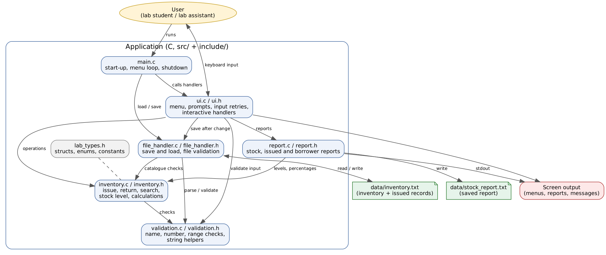

# Project Proposal: Lab Component Tracker

## 1. Project Title

**Lab Component Tracker: Electronic Component Issue and Return Management for a College Lab**

## 2. Student Information

| Field | Details |
|---|---|
| Student name |Shruti Lonkar|
| Roll number |612507185|
| Division / batch |EnTc Div 2|
| Project title |Electronics Lab Component Tracker |
| GitHub repository link |https://github.com/s7rvti/electronics-lab-components|

## 3. Engineering Scenario

**Domain:** Laboratory management (Education / Electronics).

**Situation:** An electronics lab owns a fixed number of common components: resistors, capacitors, inductors, transistors, MOSFETs and jumper wires. Students borrow them for experiments and are supposed to return them afterwards.

**Where it happens:** In the lab, at the component counter, every practical session.

**Who faces the problem:** Students (who need the right part quickly) and the lab assistant (who must know what is left and who has what).

**Why software helps:** A program can check availability instantly, remember who holds what even after it is closed, warn when stock is low, and remove the guesswork of paper registers.

## 4. Problem Statement

In an electronics lab, students and lab staff currently track borrowed components on paper or by memory. The current method results in wrong or missing counts, students taking the wrong value (for example a 1k resistor instead of 10k), parts never being returned, and shortages discovered only when an experiment is already under way. The proposed software will provide issue and return logging with specification choice, stock checking, low-stock detection, search and reports, so that students can get the right component quickly and staff always know the real stock and who is holding what.

**Information to be managed:**
- Each component type and its fixed total quantity
- The specification of each item (e.g. 10k, BC547)
- Who borrowed what, and how many
- The currently available quantity of each component

**Expected result:** An accurate, saved record of stock and borrowings, with reports that show what needs restocking.

## 5. Proposed Solution

A menu-driven C application with these operations:

- **Issue:** the user enters a name, chooses a component from a list, chooses an exact type from a numbered list, and enters a quantity. The program checks stock and records the issue.
- **Return:** the user enters a name and a component. If that person never issued it, the program says so immediately. Otherwise it shows what they hold and takes back the chosen quantity.
- **Search:** show everything a named borrower holds.
- **Reports:** a stock report (total, available, issued, utilisation %, status, scarcest first), an issued-components report, and a report saved to a text file.
- **Persistence:** all data is saved to a text file after every change and loaded at start-up.

**Outputs:** on-screen menus and messages, the stock and issued reports, `data/inventory.txt` (saved data) and `data/stock_report.txt` (saved report).

## 6. Target Users

| User | How they use the system |
|---|---|
| Student | Takes and returns components, checks what they currently hold |
| Lab assistant | Views the stock report, finds who holds a part, checks restock needs, saves the report |
| Faculty / lab in-charge | Reads the saved report to plan purchases |

## 7. Project Scope

### In scope
- Six component types with fixed quantities
- Predefined specification lists for five of them
- Issue, return (including partial), search by borrower
- Stock status calculation (OK / LOW / OUT OF STOCK) and sorting by scarcity
- Stock, issued and borrower reports on screen; report saved to a file
- Text-file storage and recovery from bad files
- Input validation and error handling
- Unit tests with Google Test, Makefile automation, documentation

### Out of scope
- Graphical interface or web interface
- User accounts, passwords or roles
- Due dates, fines and reminders
- Purchasing / adding new stock at run time
- Network or multi-user simultaneous access
- Barcode or hardware integration

### Assumptions
- One person uses the program at a time
- Borrower names are entered as a single word (letters, digits, `_`, `-`)
- The component list and quantities are decided by the lab and change rarely

### Constraints
- C language (C99) only for the application; only `stdio.h` is used
- Tests are written in C++ with Google Test
- Must compile warning-free with `-Wall -Wextra -Wpedantic`

## 8. Functional Requirements

| ID | Requirement |
|---|---|
| FR-01 | The system shall issue a quantity of a component to a named borrower. |
| FR-02 | The system shall let the user choose the specification from a displayed list for every component except jumper wires. |
| FR-03 | The system shall refuse to issue more than the available quantity. |
| FR-04 | The system shall merge repeated issues of the same component and specification to the same borrower into one record. |
| FR-05 | The system shall accept a return only for items the borrower holds, and only up to the quantity held. |
| FR-06 | The system shall inform the user and stop the return if the borrower never issued the chosen component. |
| FR-07 | The system shall validate names, menu choices, component numbers, specification numbers and quantities. |
| FR-08 | The system shall save the inventory and issued records to a text file after every successful change and load them at start-up. |
| FR-09 | The system shall detect a missing, empty, damaged or inconsistent data file and continue safely. |
| FR-10 | The system shall search issued records by borrower name. |
| FR-11 | The system shall show a stock report with total, available, issued, utilisation percentage and status for each component, scarcest first. |
| FR-12 | The system shall determine stock status (out of stock, low, ok) and warn the user when an issue leaves a component low or out of stock. |
| FR-13 | The system shall list all currently issued components. |
| FR-14 | The system shall display every component type and its specifications. |
| FR-15 | The system shall save the stock and issued reports to a text file. |

## 9. Non-Functional Requirements

| ID | Requirement |
|---|---|
| NFR-01 | **Readability:** consistent naming, four-space indentation, comments explaining purpose and parameters. |
| NFR-02 | **Modular design:** at least three implementation modules besides `main.c`, each with one responsibility. |
| NFR-03 | **Input validation:** invalid input must never crash the program or leave it in an undefined state. |
| NFR-04 | **Error handling:** operations return status codes and callers check them. |
| NFR-05 | **Warning-free compilation** with `-Wall -Wextra -Wpedantic`. |
| NFR-06 | **Automated unit testing** with Google Test, at least ten meaningful tests, run by `make test`. |
| NFR-07 | **Build automation:** `make all`, `make run`, `make test`, `make clean`. |
| NFR-08 | **Documentation:** README, proposal, design document, diagrams. |
| NFR-09 | **Version control:** Git with meaningful commits, published on GitHub. |
| NFR-10 | **Data safety:** a damaged file must not cause wrong stock figures to be loaded. |

## 10. Initial Modules

| Module | Responsibility |
|---|---|
| `main` | Start-up, load data, run the menu loop, save and exit |
| `ui` | Menu, prompts with retries, interactive handlers |
| `inventory` | Component catalogue and rules: issue, return, search, stock level, calculations |
| `validation` | Checking names, numbers and ranges; string helpers |
| `file_handler` | Saving and loading the data file; checking its contents |
| `report` | Building the text reports |

## 11. Initial Architecture

## 12. High-Level Workflow

1. The user starts the program. It loads the saved data (or starts with full stock).
2. The menu is shown and the user picks an action.
3. Invalid choices are rejected and asked again.
4. For **take**: name, component, type, quantity, then issue, confirmation, low-stock warning, save.
5. For **return**: name, component, check that something is held, choose item, quantity, then return and save.
6. For **view / search / report**: the matching report is shown or saved.
7. The user picks **Exit** (or input ends). The data is saved and the program ends.

The full flowchart is in [flowchart.png](flowchart.png).

## 13. Planned C Concepts

| Concept | Why it is needed |
|---|---|
| Structures | Group a borrowing (`IssueRecord`) and the whole state (`Inventory`) |
| Enumerations | Name component types, status codes, stock levels and menu choices |
| Constants | Remove magic numbers (limits, 20% low-stock rule, file names) |
| Arrays | Store records and the specification lists |
| Strings | Names and specifications, with bounded copying |
| Pointers | Pass the inventory to functions, check for NULL, accept `FILE *` in reports |
| Functions | One responsibility each, so they can be unit-tested |
| File handling | Persist data between runs, save reports |
| Status codes | Report every failure the same way |
